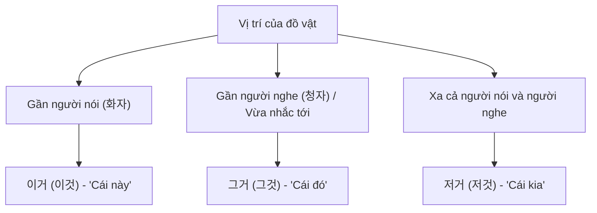

#tienghan/socap #seoul1a/bai2

> **Nguồn giáo trình:** _Seoul National University Korean 1A Student's Book (서울대 한국어 1A)_, Viện Giáo dục Ngôn ngữ Đại học Quốc gia Seoul (SNU LEI), Trang 70 – 90, Ngữ pháp bổ trợ tr. 225 – 227, Lời thoại tr. 249.  
> **Chủ đề chính:** Chỉ định từ, Tên gọi các đồ vật xung quanh, Mua sắm vật dụng cơ bản (사물 이름, 지시대명사, 물건 구입 - Identifying Objects, Demonstratives & Purchasing Items).

---

## 1. Từ vựng cốt lõi (어휘 - Vocabulary)

### A. Đồ dùng học tập trong lớp học (학용품 - School Supplies)

| STT | Từ vựng | Chữ Hán | Phát âm | Nghĩa tiếng Việt | Nghĩa tiếng Anh | Ví dụ minh họa |
| :--- | :--- | :--- | :--- | :--- | :--- | :--- |
| 1 | **책상** | 冊床 | [책쌍] | Bàn học, bàn làm việc | Desk | 책상 위에 책이 있어요. *(Trên bàn học có sách.)* |
| 2 | **의자** | 椅子 | [의자] | Ghế ngồi | Chair | 교실에 의자가 있어요. *(Trong lớp học có ghế.)* |
| 3 | **책** | 冊 | [책] | Sách, cuốn sách | Book | 한국어 책을 읽어요. *(Đọc sách tiếng Hàn.)* |
| 4 | **공책** | 空冊 | [공책] | Vở ghi chép, tập viết | Notebook | 공책에 이름을 써요. *(Viết tên vào vở.)* |
| 5 | **볼펜** | (Anh: Ballpoint pen) | [볼펜] | Bút bi | Ballpoint pen | 볼펜하고 공책을 사요. *(Mua bút bi và vở.)* |
| 6 | **연필** | 鉛筆 | [연필] | Bút chì | Pencil | 저거는 연필이에요. *(Cái kia là bút chì.)* |
| 7 | **지우개** | | [지우개] | Cục tẩy, cục gôm | Eraser | 지우개 좀 주세요. *(Làm ơn cho tôi mượn cục tẩy.)* |
| 8 | **필통** | 筆筒 | [필통] | Hộp bút, bóp đựng bút | Pencil case | 필통 안에 볼펜이 있어요. *(Trong hộp bút có bút bi.)* |
| 9 | **가방** | (Hà Lan: Kabaas) | [가방] | Cặp sách, ba lô, túi xách | Bag / Backpack | 가방이 아주 커요. *(Cặp sách rất to.)* |
| 10 | **자** | | [자] | Cây thước kẻ | Ruler | 자가 있어요? *(Bạn có thước kẻ không?)* |
| 11 | **사전** | 辭典 | [사전] | Cuốn từ điển | Dictionary | 영어 사전이 있어요. *(Có từ điển tiếng Anh.)* |
| 12 | **전자사전** | 電子辭典 | [전자사전] | Từ điển điện tử | Electronic dictionary | 전자사전 있어요? *(Có từ điển điện tử không?)* |

---

### B. Vật dụng cá nhân & Tiện nghi đời sống (일상 생활용품 & 가구 - Daily Goods & Furniture)

| STT | Từ vựng | Chữ Hán | Phát âm | Nghĩa tiếng Việt | Nghĩa tiếng Anh | Ví dụ minh họa |
| :--- | :--- | :--- | :--- | :--- | :--- | :--- |
| 13 | **시계** | 時計 | [시게] | Đồng hồ (đeo tay, treo tường) | Clock / Watch | 벽에 시계가 있어요. *(Trên tường có đồng hồ.)* |
| 14 | **모자** | 帽子 | [모자] | Mũ, nón | Hat / Cap | 이거는 모자예요. *(Cái này là cái mũ.)* |
| 15 | **우산** | 雨傘 | [우산] | Cây dù, cái ô | Umbrella | 우산이 없어요. *(Tôi không có ô.)* |
| 16 | **신문** | 新聞 | [신문] | Báo chí, tờ báo | Newspaper | 한국신문 주세요. *(Làm ơn cho tôi tờ báo Hàn Quốc.)* |
| 17 | **잡지** | 雜誌 | [잡찌] | Tạp chí | Magazine | 패션 잡지를 봐요. *(Xem tạp chí thời trang.)* |
| 18 | **카메라** | (Anh: Camera) | [카메라] | Máy ảnh, máy chụp hình | Camera | 카메라가 비싸요. *(Máy ảnh đắt tiền.)* |
| 19 | **안경** | 眼鏡 | [안경] | Kính mắt, cặp mắt kính | Glasses | 안경이 책상 위에 있어요. *(Mắt kính ở trên bàn học.)* |
| 20 | **휴대폰** | 携帶phone | [휴대폰] | Điện thoại di động | Mobile phone | 휴대폰 번호가 몇 번이에요? *(Số điện thoại bạn là mấy?)* |
| 21 | **창문** | 窓門 | [창문] | Cửa sổ | Window | 창문 옆에 침대가 있어요. *(Kế bên cửa sổ có giường ngủ.)* |
| 22 | **지도** | 地圖 | [지도] | Bản đồ | Map | 세계 지도를 봐요. *(Nhìn bản đồ thế giới.)* |
| 23 | **지갑** | 紙匣 | [지갑] | Ví tiền, bóp tiền | Wallet | 지갑 안에 돈이 있어요. *(Trong ví có tiền.)* |
| 24 | **침대** | 寢臺 | [침대] | Giường ngủ | Bed | 방에 침대가 있어요. *(Trong phòng có giường ngủ.)* |
| 25 | **냉장고** | 冷藏庫 | [냉장고] | Tủ lạnh | Refrigerator | 냉장고에 물이 있어요. *(Trong tủ lạnh có nước.)* |
| 26 | **컴퓨터** | (Anh: Computer) | [컴퓨터] | Máy vi tính | Computer | 방에 컴퓨터가 있어요. *(Trong phòng có máy vi tính.)* |
| 27 | **텔레비전** | (Anh: Television) | [텔레비전] | Ti vi, truyền hình | Television | 텔레비전이 없어요. *(Không có ti vi.)* |

---

### C. Chỉ định từ, Từ nghi vấn & Cụm từ thông dụng (지시대명사 & 기타 표현)

| STT | Từ vựng | Cấu tạo / Từ loại | Phát âm | Nghĩa tiếng Việt | Nghĩa tiếng Anh | Ghi chú văn cảnh |
| :--- | :--- | :--- | :--- | :--- | :--- | :--- |
| 28 | **이거** | Chỉ định từ (văn nói) | [이거] | Cái này (gần người nói) | This / This one | Dạng đầy đủ: **이것** |
| 29 | **그거** | Chỉ định từ (văn nói) | [그거] | Cái đó (gần người nghe / vừa nhắc) | That / That one | Dạng đầy đủ: **그것** |
| 30 | **저거** | Chỉ định từ (văn nói) | [저거] | Cái kia (xa cả hai người) | That over there | Dạng đầy đủ: **저것** |
| 31 | **무엇 (뭐)** | Từ nghi vấn | [무얻 / 뭐] | Cái gì | What | Dạng khẩu ngữ rút gọn: **뭐** |
| 32 | **주세요** | Động từ 주다 + 세요 | [주세요] | Xin hãy cho tôi..., làm ơn cho tôi... | Please give me | Dùng khi mua sắm, gọi món, nhờ vả |
| 33 | **한국어로** | 한국어 + -로 | [한국어로] | Bằng tiếng Hàn Quốc | In Korean | 이거는 한국어로 뭐예요? |
| 34 | **어서 오세요** | Câu chào cửa hàng | [어서 오세요] | Xin mời vào! Kính chào quý khách! | Welcome! | Lời chào tiêu chuẩn tại các cửa hiệu |
| 35 | **여기 있어요** | 여기 + 있어요 | [여기 이써요] | Của bạn ở đây ạ / Ở đây này | Here it is | Lời đáp khi trao đồ cho người khác |
| 36 | **좀** | Phó từ (조금 rút gọn) | [좀] | Một chút, chút xíu (làm câu nói mềm mỏng) | A little / Please | 지우개 좀 주세요. *(Cho tôi mượn cục tẩy với.)* |
| 37 | **룸메이트** | (Anh: Roommate) | [룸메이트] | Bạn cùng phòng | Roommate | 제 룸메이트는 정우예요. *(Bạn cùng phòng tôi là Jungwoo.)* |

---

### D. Vật phẩm văn hóa truyền thống đặc trưng (한국에만 있는 물건 - Culture Items)

| STT | Từ vựng | Chữ Hán | Phát âm | Nghĩa tiếng Việt | Ý nghĩa văn hóa dân gian Hàn Quốc |
| :--- | :--- | :--- | :--- | :--- | :--- |
| 38 | **효자손** | 孝子손 | [효자손] | Cây gãi lưng (nghĩa đen: Tay con hiếu thảo) | Dụng cụ bằng gỗ/tre uốn cong như bàn tay, giúp người già tự gãi lưng khi không có con cháu bên cạnh; thể hiện tấm lòng hiếu thảo. |
| 39 | **소반** | 小盤 | [소반] | Chiếc bàn ăn nhỏ chân thấp truyền thống | Bàn ăn/bàn trà bằng gỗ nhỏ gọn có chân thấp, dùng để bưng cả mâm cơm từ bếp vào phòng có hệ thống sưởi sàn Ondol. |
| 40 | **죽부인** | 竹夫人 | [죽부인] | Gối ôm bằng tre đan (Trúc phu nhân) | Chiếc gối ôm đan bằng nan tre rỗng ruột hình trụ, giúp không khí đối lưu thoáng mát khi ôm ngủ vào mùa hè nóng ẩm. |

---

## 2. Ngữ pháp trọng tâm (핵심 문법)

### 2.1. Biểu hiện sở hữu và tồn tại: $N\text{이/가 있어요[없어요]}$

> [!NOTE] Khái niệm & Chức năng
> Đuôi diễn đạt $N\text{이/가 있어요}$ dùng để biểu thị **chủ thể đang sở hữu hoặc có một đồ vật, con người** nào đó.  
> Trái lại, $N\text{이/가 없어요}$ diễn đạt việc **không có hoặc không sở hữu** đồ vật, con người đó.  
> $\text{이/가}$ là **tiểu từ chủ ngữ**, gắn trực tiếp sau danh từ được sở hữu.

#### A. Công thức kết hợp:

$$\begin{aligned}
\text{Danh từ có phụ âm cuối (받침 O)} &\longrightarrow \mathbf{N\text{이 있어요 / 없어요}} \\
\text{Danh từ không có phụ âm cuối (받침 X)} &\longrightarrow \mathbf{N\text{가 있어요 / 없어요}}
\end{aligned}$$

#### B. Bảng phân loại chi tiết:

| Danh từ | Patchim | Dạng khẳng định ("Có...") | Dạng phủ định ("Không có...") | Dịch nghĩa tiếng Việt |
| :--- | :---: | :--- | :--- | :--- |
| **우산** *(cây dù)* | O | **우산이 있어요** | **우산이 없어요** | Có ô / Không có ô |
| **책** *(sách)* | O | **책이 있어요** | **책이 없어요** | Có sách / Không có sách |
| **동전** *(tiền xu)* | O | **동전이 있어요** | **동전이 없어요** | Có tiền xu / Không có tiền xu |
| **남자 친구** *(bạn trai)* | X | **남자 친구가 있어요** | **남자 친구가 없어요** | Có bạn trai / Không có bạn trai |
| **시계** *(đồng hồ)* | X | **시계가 있어요** | **시계가 없어요** | Có đồng hồ / Không có đồng hồ |
| **지갑** *(ví tiền)* | O | **지갑이 있어요** | **지갑이 없어요** | Có ví / Không có ví |

- **Ví dụ câu thực tế:**
  - 스티븐 씨는 **남자 친구가 있어요?** — 아니요, **남자 친구가 없어요.** *(Steven có bạn trai không? — Không, tôi không có bạn trai.)*
  - 지금 **우산이 있어요?** — 네, **우산이 있어요.** *(Bây giờ bạn có ô không? — Có, tôi có ô.)*
  - 정우는 **여자 친구가 없어요.** *(Jungwoo chưa có bạn gái.)*

> [!TIP] Hiện tượng lược bỏ tiểu từ $이/가$ trong giao tiếp thực tế
> Trong khẩu ngữ hội thoại thường nhật, khi ngữ cảnh đã hoàn toàn sáng tỏ, người Hàn Quốc rất hay **lược bỏ tiểu từ $이/가$**:
> - 동전(이) 있어요? $\longrightarrow$ **동전 있어요?** *(Bạn có tiền xu không?)*
> - 돈(이) 없어요. $\longrightarrow$ **돈 없어요.** *(Tôi không có tiền.)*
> - 시간(이) 있어요? $\longrightarrow$ **시간 있어요?** *(Bạn có rảnh/có thời gian không?)*

> [!IMPORTANT] Phân biệt rõ hai cấu trúc: $N\text{이/가 있다/없다}$ vs $N\text{에 있다/없다}$
> - **Bài 2 ($N\text{이/가 있어요}$):** Nhấn mạnh vào **quan hệ sở hữu** — "Ai đó CÓ cái gì" *(Ví dụ: 저는 차가 있어요 — Tôi có xe hơi).*
> - **Bài 4 ($N\text{에 있어요}$):** Nhấn mạnh vào **vị trí không gian** — "Cái gì ĐANG Ở ĐÂU" *(Ví dụ: 차가 주차장에 있어요 — Xe hơi đang ở bãi đỗ xe).*

---

### 2.2. Đại từ chỉ định làm chủ ngữ: $\text{이거는 / 그거는 / 저거는 } N\text{이에요/예요}$

> [!NOTE] Bản chất của bộ ba Chỉ định từ (이 / 그 / 저)
> Trong tiếng Hàn, việc lựa chọn đại từ chỉ định phụ thuộc nghiêm ngặt vào **khoảng cách vật lý hoặc tâm lý** giữa đồ vật với **Người nói (화자)** và **Người nghe (청자)**:
> - **이거 (이것):** Vật ở **gần người nói** (gần người đang phát ngôn).
> - **그거 (그것):** Vật ở **gần người nghe** (hoặc vật vừa được nhắc đến trong bối cảnh câu chuyện).
> - **저거 (저것):** Vật ở **xa cả người nói lẫn người nghe** (nằm trong tầm mắt của cả hai nhưng ở khoảng cách xa).



#### A. Công thức kết hợp với đuôi xác định $N\text{이에요/예요}$:

$$\begin{aligned}
\text{Chủ ngữ chỉ định } (\mathbf{이거는 / 그거는 / 저거는}) + \mathbf{N\text{이에요}} \quad &(\text{Nếu } N \text{ có 받침}) \\
\text{Chủ ngữ chỉ định } (\mathbf{이거는 / 그거는 / 저거는}) + \mathbf{N\text{예요}} \quad &(\text{Nếu } N \text{ không có 받침})
\end{aligned}$$

#### B. Bảng mẫu câu minh họa:

| Chỉ định từ | Danh từ vị ngữ | Patchim | Câu hoàn chỉnh | Dịch nghĩa tiếng Việt |
| :--- | :--- | :---: | :--- | :--- |
| **이거는** *(cái này)* | **모자** *(mũ)* | X | **이거는 모자예요.** | Cái này là cái mũ. |
| **이거는** *(cái này)* | **책상** *(bàn)* | O | **이거는 책상이에요.** | Cái này là bàn học. |
| **그거는** *(cái đó)* | **지도** *(bản đồ)* | X | **그거는 지도예요.** | Cái đó là bản đồ. |
| **그거는** *(cái đó)* | **공책** *(vở)* | O | **그거는 공책이에요.** | Cái đó là quyển vở. |
| **저거는** *(cái kia)* | **시계** *(đồng hồ)* | X | **저거는 시계예요.** | Cái kia là đồng hồ. |
| **저거는** *(cái kia)* | **사전** *(từ điển)* | O | **저거는 사전이에요.** | Cái kia là cuốn từ điển. |

#### C. Các biến thể ngữ pháp quan trọng:

1. **Rút gọn trong khẩu ngữ hàng ngày:**
   - Tiểu từ chủ đề 는 có thể lược bỏ:
     - 이거는 뭐예요? $\longrightarrow$ **이거 뭐예요?** *(Cái này là cái gì?)*
     - 그거는 책이에요? $\longrightarrow$ **그거 책이에요?** *(Cái đó là sách hả?)*
     - 저거는 연필이에요? $\longrightarrow$ **저거 연필이에요?** *(Cái kia là bút chì à?)*
2. **Dạng trang trọng, lịch sự nghi thức (격식체):**
   - Thay `이거` bằng `이것`, thay `이에요/예요` bằng `입니다/입니까?`:
     - **이것은 무엇입니까?** *(Đây là vật gì?)*
     - **그것은 제 한국어 책입니다.** *(Đó là sách tiếng Hàn của tôi.)*
     - **저것은 시계입니다.** *(Kia là chiếc đồng hồ.)*
3. **Quy tắc chuyển đổi đại từ khi đối thoại:**
   - Khi Người hỏi dùng **이거** (vì vật gần họ), Người đáp sẽ chuyển thành **그거** (vì vật ở gần đối phương):
     - A: **이거는** 모자예요? *(Cái này là cái mũ hả?)*
     - B: 네, **그거는** 모자예요. *(Vâng, cái đó là cái mũ đấy.)*

---

### 2.3. Đưa ra yêu cầu, mua bán lịch sự: $N\text{ 주세요}$

> [!NOTE] Khái niệm & Ứng dụng
> `주세요` bắt nguồn từ động từ `주다` (cho, tặng) kết hợp với đuôi kính ngữ tôn kính `-(으)세요`.  
> Mang ý nghĩa: **"Xin hãy cho tôi N" / "Làm ơn lấy cho tôi N"**.  
> Đây là mẫu câu cốt lõi nhất được sử dụng khi đi **mua hàng, đi chợ, gọi món trong nhà hàng**, hoặc khi cần **mượn đồ vật** từ người khác.

#### A. Công thức:

$$\mathbf{N} + \mathbf{주세요}$$

- **Ví dụ mua bán thực tế:**
  - 사과 **주세요.** *(Cho tôi táo.)*
  - 물 **주세요.** *(Làm ơn cho tôi nước lọc.)*
  - 한국신문 **주세요.** *(Cho tôi tờ báo Hàn Quốc.)*
  - 그럼 그거 **주세요.** *(Thế thì xin lấy cho tôi cái đó.)*

> [!TIP] Thêm phó từ '좀' để tăng độ nhã nhặn, lịch thiệp
> Khi đưa ra yêu cầu hoặc nhờ vả mượn đồ từ bạn bè, đồng nghiệp, việc chèn thêm phó từ **좀** (nghĩa là "một chút / làm ơn") sẽ khiến câu nói trở nên vô cùng mềm mại, lịch sự và khiêm nhường:
> - 지우개 **좀 주세요.** *(Làm ơn cho tôi mượn cục tẩy một chút nhé.)*
> - 볼펜 **좀 주세요.** *(Cho tôi mượn cây bút bi với ạ.)*
> - 물 **좀 주세요.** *(Làm ơn cho tôi xin chút nước uống.)*

---

### 2.4. Liên từ nối danh từ: $N\text{하고 } N$, $N\text{과/와 } N$

> [!NOTE] Khái niệm & Phân biệt ngữ vực
> Cả hai cấu trúc đều mang ý nghĩa nối hai hoặc nhiều danh từ lại với nhau tương đương từ **"và, cùng với"** trong tiếng Việt.
> - **하고:** Dùng cực kỳ phổ biến trong **khẩu ngữ hội thoại đời sống**, không cần phân biệt danh từ có hay không có patchim.
> - **과/와:** Mang sắc thái **trang trọng, văn viết hoặc diễn thuyết**, bắt buộc phải biến đổi dựa theo sự tồn tại của patchim.

#### A. Bảng quy tắc so sánh:

| Đặc điểm | Cấu trúc $N\text{하고 } N$ | Cấu trúc $N\text{과/와 } N$ |
| :--- | :--- | :--- |
| **Quy tắc nối** | Gắn trực tiếp sau mọi danh từ (không xét patchim) | • Danh từ có 받침 $\longrightarrow \mathbf{N\text{과}}$<br>• Danh từ không 받침 $\longrightarrow \mathbf{N\text{와}}$ |
| **Ví dụ có 받침** | **책상하고** 의자<br>**학생하고** 선생님 | **책상과** 의자<br>**학생과** 선생님 |
| **Ví dụ không 받침** | **모자하고** 안경<br>**지우개하고** 연필 | **모자와** 안경<br>**지우개와** 연필 |
| **Ngữ cảnh sử dụng** | Văn nói thân mật, mua sắm hàng ngày | Văn bản, bài viết, phát biểu trang trọng |

#### B. Mở rộng cấu trúc trong khẩu ngữ: $N\text{(이)랑 } N$
- Trong khẩu ngữ giao tiếp giữa bạn bè thân thiết, người Hàn rất hay dùng `-(이)랑`:
  - Có patchim: **학생이랑** 선생님 *(Học sinh và thầy giáo)*
  - Không patchim: **지우개랑** 연필 *(Cục tẩy và bút chì)*

> [!CAUTION] Lỗi ngữ pháp người học hay mắc phải: Không dùng 하고 để nối 2 câu độc lập!
> - **Sai:** *이거는 책상이에요. 하고 저거는 의자예요. (X)*
> - **Đúng:** 이거는 책상이에요. **그리고** 저거는 의자예요. (O)  
> *(Để nối 2 câu/mệnh đề riêng biệt, bắt buộc phải dùng liên từ liên kết câu **그리고**).*

---

## 3. Hội thoại thực hành (말하기)

### 3.1. Hội thoại 1: Hỏi đồ vật trong cửa hiệu văn phòng phẩm (말하기 1 - Track 22, Trang 76)

> **Bối cảnh:** Stephen (스티븐) bước vào một tiệm văn phòng phẩm tổng hợp (BEST Office) để tìm mua từ điển và hỏi tên tiếng Hàn của các đồ dùng học tập được bày trên quầy.

```
[Tại quầy văn phòng phẩm BEST Office]
스티븐:  전자사전 있어요?
아주머니: 아니요, 없어요.
스티븐:  이거는 한국어로 뭐예요?
아주머니: 자예요.
스티븐:  저거는 연필이에요?
아주머니: 아니요, 볼펜이에요.
```

#### A. Bảng phân tích chi tiết từng lời thoại:

| Nhân vật | Câu thoại tiếng Hàn | Chữ Hán | Phát âm | Dịch nghĩa tiếng Việt | Phân tích ngữ pháp & Ngữ cảnh |
| :--- | :--- | :--- | :--- | :--- | :--- |
| **스티븐** | 전자사전 있어요? | 電子辭典 | [전자사전 이써요?] | Ở đây có từ điển điện tử không ạ? | Danh từ + 있어요? (Hỏi có mặt hàng cần mua hay không). |
| **아주머니** | 아니요, 없어요. | | [아니요, 업써요.] | Không có cháu ơi. | 아니요 + 없어요 (Phủ định sự sở hữu/tồn tại). |
| **스티븐** | 이거는 한국어로 뭐예요? | 韓國語- | [이거는 한구거로 뭐예요?] | Cái này trong tiếng Hàn gọi là gì ạ? | Mẫu câu vàng hỏi tên đồ vật: `이거는 한국어로 뭐예요?` |
| **아주머니** | 자예요. | | [자예요.] | Là cây thước kẻ đấy. | Danh từ 자 (không patchim) kết hợp đuôi 예요. |
| **스티븐** | 저거는 연필이에요? | 鉛筆- | [저거는 연피리에요?] | Cái kia đằng xa là bút chì phải không ạ? | 저거 (xa cả hai) + N có patchim 연필 + 이에요? |
| **아주머니** | 아니요, 볼펜이에요. | | [아니요, 볼페nieyo.] | Không phải, là bút bi cháu à. | Đính chính: Bác bán hàng chỉ rõ đó là bút bi. |

---

### 3.2. Hội thoại 2: Mua báo chí tại quầy sạp (말하기 2 - Track 25, Trang 79)

> **Bối cảnh:** Julien (줄리앙) ghé vào một sạp báo vỉa hè (Kiosk) trên đường phố Seoul để tìm mua tờ báo tiếng Hàn đọc luyện tập mỗi ngày.

```
[Tại sạp báo vỉa hè Kiosk]
아주머니: 어서 오세요.
줄리앙:  신문 있어요?
아주머니: 네, 있어요.
         한국신문하고 나라신문이 있어요.
줄리앙:  한국신문 주세요.
아주머니: 여기 있어요.
```

#### A. Bảng phân tích chi tiết từng lời thoại:

| Nhân vật | Câu thoại tiếng Hàn | Chữ Hán | Phát âm | Dịch nghĩa tiếng Việt | Phân tích ngữ pháp & Ngữ cảnh |
| :--- | :--- | :--- | :--- | :--- | :--- |
| **아주머니** | 어서 오세요. | | [어서 오세요] | Xin kính chào quý khách! | Lời chào mời khách bước vào cửa hàng chuẩn mực. |
| **줄리앙** | 신문 있어요? | 新聞 | [신문 이써요?] | Ở đây có bán báo không ạ? | Hỏi tìm loại mặt hàng tổng quát (신문). |
| **아주머니** | 네, 있어요. 한국신문하고 나라신문이 있어요. | 新聞, 나라新聞 | [네, 이써요. 한국신문하고 나라신무니 이써요.] | Vâng, có chứ. Có báo Hàn Quốc (Hanguk Shinmun) và báo Quốc gia (Nara Shinmun). | Dùng liên từ 하고 nối tên hai tờ báo tiêu biểu. Nối âm [나라신무니]. |
| **줄리앙** | 한국신문 주세요. | 韓國新聞 | [한국신문 주세요.] | Xin lấy cho cháu tờ báo Hàn Quốc ạ. | Cấu trúc mua hàng: `Tên món đồ + 주세요`. |
| **아주머니** | 여기 있어요. | | [여기 이써요.] | Của cháu đây nhé. | Lời nói nhã nhặn khi đưa đồ vật tận tay khách. |

---

## 4. Luyện nghe thực tế (듣고 말하기)

### 4.1. Luyện nghe 1 (듣기 1 - Track 26, Trang 80 & 249)

> **Nhiệm vụ:** Nghe 4 đoạn đối thoại ngắn và nối đúng với các đồ vật tương ứng được minh họa trong hình ảnh.

#### Audio Script (듣기 대본):
```
1) 남: 이거는 모자예요?
   여: 네, 그거는 모자예요.

2) 여: 저거는 한국어로 뭐예요?
   남: 책상이에요.

3) 여: 이거는 한국어로 뭐예요?
   남: 이거는 의자예요.

4) 남: 저거는 텔레비전이에요?
   여: 아니요, 저거는 텔레비전이 아니에요. 컴퓨터예요.
```

#### Bản dịch và Phân tích:
- **Đoạn 1:** Nam: *"Cái này là cái mũ hả?"* — Nữ: *"Vâng, cái đó là cái mũ."* $\to$ Đồ vật xác định: **모자** (Cái mũ).
- **Đoạn 2:** Nữ: *"Cái kia tiếng Hàn là gì thế?"* — Nam: *"Là cái bàn học đấy."* $\to$ Đồ vật xác định: **책상** (Bàn học).
- **Đoạn 3:** Nữ: *"Cái này tiếng Hàn gọi là gì?"* — Nam: *"Cái này là cái ghế."* $\to$ Đồ vật xác định: **의자** (Cái ghế).
- **Đoạn 4:** Nam: *"Cái kia là ti vi phải không?"* — Nữ: *"Không, cái kia không phải ti vi đâu. Là máy vi tính đấy."* $\to$ Đồ vật xác định: **컴퓨터** (Máy tính).

---

### 4.2. Luyện nghe 2 (듣기 2 - Track 27, Trang 81 & 249)

> **Nhiệm vụ:** Nghe cuộc hội thoại mua sắm tại hiệu sách tổng hợp và đánh dấu đúng/sai vào bảng khảo sát.

#### Audio Script (듣기 대본):
```
여: 어서 오세요.
남: 한국어 사전 있어요?
여: 네, 있어요.
남: 전자사전이에요?
여: 네, 전자사전이에요.
남: 그럼 그거 주세요.
여: 여기 있어요.
남: 음, 잡지 있어요?
여: 네, 한국 잡지하고 미국 잡지가 있어요.
남: 일본 잡지는 없어요?
여: 네, 없어요.
```

#### Bản dịch và Phân tích câu hỏi:
- **Lời thoại người bán:** *"Xin chào quý khách!"*
- **Người mua hỏi:** *"Có từ điển tiếng Hàn không ạ?"*
- **Người bán đáp:** *"Có ạ."*
- **Người mua hỏi kỹ:** *"Có phải từ điển điện tử không ạ?"*
- **Người bán xác nhận:** *"Vâng, là từ điển điện tử."*
- **Người mua quyết định:** *"Thế thì lấy cho tôi cái đó nhé."*
- **Người bán trao hàng:** *"Của quý khách đây ạ."*
- **Người mua hỏi tiếp:** *"Ừm, ở đây có tạp chí không?"*
- **Người bán giới thiệu:** *"Vâng, có tạp chí Hàn Quốc và tạp chí Mỹ."*
- **Người mua tìm kiếm:** *"Tạp chí Nhật Bản thì không có à?"*
- **Người bán trả lời:** *"Vâng, không có ạ."*

> [!NOTE] Điểm ngữ pháp chú ý trong câu phủ định kiểu Hàn
> Khi người nam hỏi: *"일본 잡지는 없어요?"* (Không có tạp chí Nhật Bản à?), người nữ đáp: **"네, 없어요."** (Vâng, đúng là không có).  
> Trong tư duy tiếng Hàn, khi trả lời câu hỏi phủ định, nếu đồng ý với nhận định phủ định của người hỏi, ta dùng **네** *(Đúng như bạn nghĩ, điều đó không tồn tại)*.

---

## 5. Đọc hiểu văn bản (읽고 쓰기 - Trang 83)

### Bài đọc: Trang Blog cá nhân của Stephen (스티븐 블로그)

```
[스티븐 블로그 - 제 방이에요]
스티븐 | 20××. 10. 06.

안녕하세요?
저는 스티븐이에요.
서울대학교 학생이에요.

제 방이에요.
침대와 책상, 의자가 있어요.
컴퓨터가 있어요.
텔레비전과 냉장고는 없어요.

저는 룸메이트가 있어요.
제 룸메이트는 한국 사람이에요.
이름은 최정우예요.
정우는 여자 친구가 없어요.
```

#### A. Phân tích chi tiết nội dung từng câu:

1. **안녕하세요? 저는 스티븐이에요. 서울대학교 학생이에요.**  
   *(Xin chào các bạn? Tôi là Stephen. Tôi là sinh viên trường Đại học Quốc gia Seoul.)*  
   - Sử dụng lại cấu trúc chào hỏi và giới thiệu thân phận ở Bài 1.
2. **제 방이에요.**  
   *(Đây là căn phòng của tôi.)*  
   - Đại từ sở hữu `제` = của tôi (dạng khiêm nhường kính ngữ của `저의`).
3. **침대와 책상, 의자가 있어요.**  
   *(Trong phòng có giường ngủ, bàn học và ghế ngồi.)*  
   - Cấu trúc nối danh từ trang trọng: `침대와` (침대 không patchim nên đi với `와`).
4. **컴퓨터가 있어요.**  
   *(Có máy vi tính.)*  
   - 컴퓨터 không patchim đi với tiểu từ chủ ngữ `가`.
5. **텔레비전과 냉장고는 없어요.**  
   *(Còn ti vi và tủ lạnh thì không có.)*  
   - `텔레비전` có patchim đi với `과`. Tiểu từ đối lập `는` ở `냉장고는` tạo sự tương phản rõ rệt với những đồ vật đang có ở trên.
6. **저는 룸메이트가 있어요. 제 룸메이트는 한국 사람이에요.**  
   *(Tôi có một người bạn cùng phòng. Bạn cùng phòng của tôi là người Hàn Quốc.)*  
   - Thể hiện sự sở hữu: `룸메이트가 있어요`.
7. **이름은 최정우예요. 정우는 여자 친구가 없어요.**  
   *(Tên của cậu ấy là Choi Jungwoo. Jungwoo hiện tại chưa có bạn gái.)*  
   - Đuôi câu phủ định sở hữu: `여자 친구가 없어요`.

#### B. Trả lời câu hỏi đọc hiểu giáo trình:

1. **방에 뭐가 있어요? (Trong phòng có những thứ gì? Chọn tất cả đồ vật đúng):**
   - ① 침대 (Giường ngủ): **Có (O)**
   - ② 책상, 의자 (Bàn, ghế): **Có (O)**
   - ③ 텔레비전 (Ti vi): **Không có (X)**
   - ④ 냉장고 (Tủ lạnh): **Không có (X)**
   - ⑤ 컴퓨터 (Máy vi tính): **Có (O)**
2. **Đúng / Sai theo nội dung bài đọc:**
   - ① 스티븐은 룸메이트가 있어요: **Đúng (O)** *(Có bạn cùng phòng là 최정우)*.
   - ② 스티븐은 여자 친구가 없어요: **Sai (X)** *(Người không có bạn gái là bạn cùng phòng Choi Jungwoo: "정우는 여자 친구가 없어요", bài không nói về bạn gái của Stephen)*.

---

## 6. Quy tắc phát âm (발음 - Track 28 & 29, Trang 87)

### Quy tắc: Phát âm nguyên âm '예' đi sau phụ âm 'ㄱ, ㅍ, ㅎ'

> [!IMPORTANT] Quy tắc phát âm chuẩn tiếng Hàn Quốc (표준 발음법 제5항)
> Nguyên âm **'예'** khi đứng độc lập hoặc đi sau phụ âm đầu `ㅇ` vẫn được phát âm đầy đủ là **[ye]** (ví dụ: `예` [ye], `예요` [yeyo]).  
> Tuy nhiên, khi phụ âm đầu là **ㄱ, ㅍ, ㅎ**, nguyên âm này thường được giản lược âm vòm và phát âm thực tế thành **[게, 페, 헤]** (âm [e]):

$$\begin{aligned}
\text{ㄱ} + \text{예} &\longrightarrow \mathbf{[게]} \\
\text{ㅍ} + \text{예} &\longrightarrow \mathbf{[페]} \\
\text{ㅎ} + \text{예} &\longrightarrow \mathbf{[헤]}
\end{aligned}$$

#### A. Các ví dụ minh họa kinh điển:

| Từ vựng | Chữ Hán | Cách viết | Phiên âm thực tế | Nghĩa tiếng Việt |
| :--- | :--- | :--- | :--- | :--- |
| **시계** | 時計 | 시계 | **[시게]** | Đồng hồ (Không đọc là [시gye]) |
| **폐** | 肺 | 폐 | **[페]** | Phổi (Bộ phận cơ thể người) |
| **지혜** | 智慧 | 지혜 | **[지헤]** | Trí tuệ, sự thông thái |
| **계란** | 鷄卵 | 계란 | **[게란]** | Quả trứng gà |
| **핑계** | 憑藉 | 핑계 | **[핑게]** | Cái cớ, lý do thoái thác |

#### B. Luyện tập câu (Track 29):

1. 저는 기자**예요** [기자예요]. *(Tôi là phóng viên nhà báo.)*  
   $\to$ Sau nguyên âm `자`, `예요` giữ nguyên âm [ye].
2. A: 이거는 뭐예요?  
   B: **시계**예요 [**시게**예요]. *(Là chiếc đồng hồ.)*  
   $\to$ `시계` đọc chuẩn là [시게].
3. A: **계란** 있어요 [**게란** 이써요]? *(Có trứng gà không ạ?)*  
   B: 아니요, **계란**은 없어요 [**게란**은 업써요]. *(Không, không có trứng gà.)*  
   $\to$ `계란` đọc chuẩn là [게란].

---

## 7. Góc văn hóa (문화 산책 - Trang 86)

### Những vật dụng truyền thống độc đáo chỉ có tại Hàn Quốc (한국에만 있는 물건)

Người nước ngoài khi lần đầu sang Hàn Quốc sinh sống thường bắt gặp những món đồ gia dụng truyền thống vô cùng lạ mắt và thắc mắc bằng mẫu câu: *"이거 뭐예요?"* (Cái này là cái gì thế?). Dưới đây là 3 vật dụng tiêu biểu nhất:

```
A: 이거 뭐예요?
B: 이거는 효자손이에요.
A: '효자손'은 뭐예요?
```

#### 1. Cây gãi lưng - Tay con hiếu thảo (효자손 - Hyo-ja-son)
- **Tên gọi:** `효자손` ghép từ chữ Hán `효자` (孝子 - Con hiếu thảo) và chữ thuần Hàn `손` (Bàn tay).
- **Ý nghĩa văn hóa:** Lưng là vị trí khó với tới nhất trên cơ thể con người. Người già khi ngứa ngáy lưng nếu có con cháu bên cạnh gãi hộ thì rất hiếu thảo. Nhưng khi con cái bận rộn đi làm xa, các cụ dùng chiếc gậy bằng gỗ hoặc tre được uốn cong đầu như bàn tay để tự gãi. Chiếc gậy thay thế bàn tay ấm áp của đứa con hiếu thảo chăm sóc cha mẹ, do đó mang tên gọi nhân văn là `효자손`.

#### 2. Chiếc bàn ăn nhỏ chân thấp Soban (소반 - So-ban)
- **Tên gọi:** Chữ Hán `小盤` (Chiếc khay / bàn ăn nhỏ).
- **Ý nghĩa văn hóa:** Nhà ở truyền thống Hàn Quốc (Hanok) sử dụng sàn sưởi `Ondol` (온돌), mọi người đều ngồi bệt dưới sàn. Chiếc bàn ăn `Soban` có chân rất thấp và trọng lượng cực kỳ nhẹ. Phụ nữ thời xưa bày biện đầy đủ cơm canh trong gian bếp rồi bưng trực tiếp cả chiếc bàn ăn này vào phòng cho cả gia đình dùng bữa, vô cùng tiện lợi và đầm ấm.

#### 3. Chiếc gối trúc phu nhân (죽부인 - Juk-bu-in)
- **Tên gọi:** Chữ Hán `竹夫人` (Người vợ bằng tre trúc).
- **Ý nghĩa văn hóa:** Vào những tháng hè nóng bức và độ ẩm cao trước khi có máy điều hòa hiện đại, người đàn ông Hàn Quốc khi ngủ thường ôm một chiếc gối dài hình trụ được đan khéo léo bằng các nan tre rỗng ruột. Cấu trúc rỗng này giúp các luồng gió lưu thông mát mẻ xung quanh cơ thể, thấm hút mồ hôi và xua tan cái nóng nực oi ả. Vì chiếc gối tre bầu bạn bên cạnh lúc ngủ ngon giấc nên được gọi đùa một cách trìu mến là "Người vợ bằng trúc".
