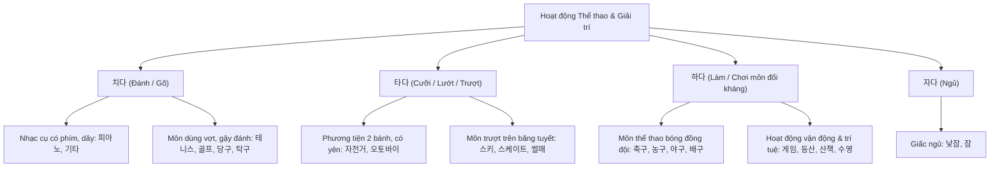
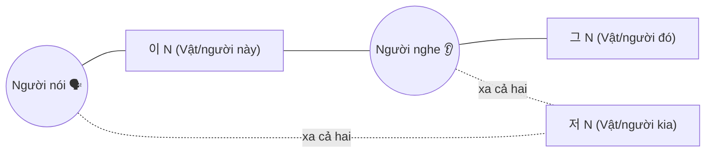
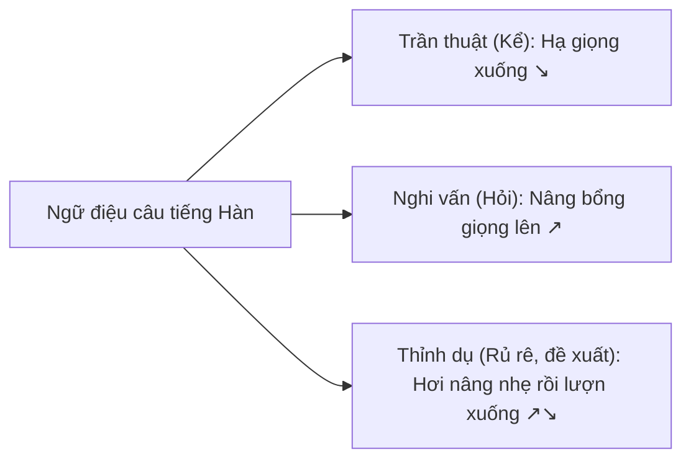
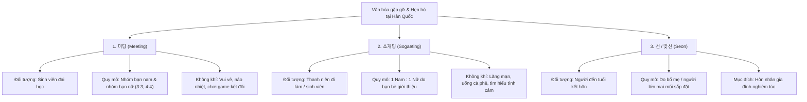

#tienghan/socap #seoul1a/bai8

> **Nguồn giáo trình:** _Seoul National University Korean 1A Student's Book (서울대 한국어 1A)_, Viện Giáo dục Ngôn ngữ Đại học Quốc gia Seoul (SNU LEI), Trang 186 – 205, Ngữ pháp bổ trợ tr. 240 – 243, Lời thoại tr. 251.  
> **Chủ đề chính:** Đề nghị và Hoạt động giải trí – Rủ rê, hẹn hò, vui chơi thể thao và bày tỏ cảm thán (제안, 여가 활동, 감탄 - Making Suggestions, Leisure Activities & Exclamations).

---

## 1. Từ vựng cốt lõi (어휘 - Vocabulary)

### A. Các môn thể thao & Hoạt động giải trí (운동과 여가 활동 - Sports & Leisure)

| STT | Từ vựng | Chữ Hán | Phiên âm | Động từ kết hợp | Nghĩa tiếng Việt | Nghĩa tiếng Anh | Ví dụ minh họa |
| :--- | :--- | :--- | :--- | :--- | :--- | :--- | :--- |
| 1 | **골프** | (Anh: Golf) | [골프] | **골프를 치다** | Môn gôn, đánh gôn | Golf | 주말에 골프를 쳐요. *(Cuối tuần tôi đi đánh gôn.)* |
| 2 | **테니스** | (Anh: Tennis) | [테니스] | **테니스를 치다** | Môn quần vợt | Tennis | 오후에 테니스 칠까요? *(Buổi chiều mình đánh tennis nhé?)* |
| 3 | **당구** | 撞球 | [당구] | **당구를 치다** | Môn bi-da, bida | Billiards | 친구하고 당구를 쳐요. *(Tôi chơi bida cùng với bạn.)* |
| 4 | **피아노** | (Ý: Piano) | [피아노] | **피아노를 치다** | Đàn piano, dương cầm | Piano | 동생이 피아노를 쳐요. *(Em gái tôi chơi đàn piano.)* |
| 5 | **기타** | (Anh: Guitar) | [기타] | **기타를 치다** | Đàn ghi-ta | Guitar | 주말에는 기타를 쳐요. *(Cuối tuần tôi đánh đàn guitar.)* |
| 6 | **자전거** | 自轉車 | [자전거] | **자전거를 타다** | Xe đạp | Bicycle | 한강에서 자전거 탈까요? *(Chúng ta đạp xe ở sông Hán nhé?)* |
| 7 | **스키** | (Anh: Ski) | [스키] | **스키를 타다** | Trượt tuyết, ván trượt | Ski | 겨울에 스키를 타요. *(Mùa đông tôi đi trượt tuyết.)* |
| 8 | **스케이트** | (Anh: Skate) | [스케이트] | **스케이트를 타다** | Trượt băng, giày trượt | Ice skate | 시청 앞에서 스케이트를 타요. *(Trượt băng trước Tòa thị chính.)* |
| 9 | **농구** | 籠球 | [농구] | **농구를 하다** | Môn bóng rổ | Basketball | 수요일에 농구를 해요. *(Tôi chơi bóng rổ vào thứ Tư.)* |
| 10 | **축구** | 蹴球 | [축구] | **축구를 하다** | Môn bóng đá | Football / Soccer | 토요일에 같이 축구 할까요? *(Thứ Bảy mình cùng đá bóng nhé?)* |
| 11 | **게임** | (Anh: Game) | [게임] | **게임을 하다** | Trò chơi điện tử | Video game | 컴퓨터 게임을 좋아해요. *(Tôi thích chơi game trên máy tính.)* |
| 12 | **낮잠** | | [낮짬] | **낮잠을 자다** | Giấc ngủ trưa | Nap | 일요일 오후에 낮잠을 자요. *(Chiều Chủ Nhật tôi ngủ trưa.)* |
| 13 | **산책** | 散策 | [산책] | **산책을 하다** | Đi dạo, tản bộ | Walk / Stroll | 저녁에 공원에서 산책해요. *(Buổi tối tôi đi dạo ở công viên.)* |
| 14 | **등산** | 登山 | [등산] | **등산을 하다 / 가다** | Leo núi | Mountain hiking | 관악산에 등산 가요. *(Tôi đi leo núi Gwanak.)* |
| 15 | **여행** | 旅行 | [여행] | **여행을 하다 / 가다** | Du lịch, chuyến đi | Travel / Trip | 방학에 제주도로 여행 가요. *(Kỳ nghỉ tôi đi du lịch đảo Jeju.)* |
| 16 | **영화** | 映畵 | [영화] | **영화를 보다** | Phim ảnh, bộ phim | Movie / Film | 이번 주말에 영화 볼까요? *(Cuối tuần này chúng mình xem phim nhé?)* |

---

### B. Phân loại động từ kết hợp thể thao chuyên dụng (동사 콜로케이션)

> [!TIP] Bí kíp ghi nhớ động từ thể thao tiếng Hàn
> Người học tiếng Hàn thường nhầm lẫn dùng động từ chung `하다` cho tất cả môn thể thao. Trong tiếng Hàn chuẩn, mỗi nhóm hoạt động bắt buộc phải đi cùng động từ đặc thù:



* **1. Nhóm `치다` (Đánh, gõ):** Áp dụng cho các nhạc cụ có phím bấm/dây đàn và môn thể thao dùng gậy/vợt đập vào bóng:
  * *골프를 치다* (chơi gôn), *테니스를 치다* (đánh tennis), *당구를 치다* (chơi bida), *탁구를 치다* (đánh bóng bàn).
  * *피아노를 치다* (chơi đàn piano), *기타를 치다* (chơi đàn ghi-ta).
* **2. Nhóm `타다` (Cưỡi, đi, trượt):** Áp dụng cho phương tiện di chuyển có bánh xe, bàn đạp hoặc các môn lướt trượt trên mặt băng/tuyết:
  * *자전거를 타다* (đi xe đạp), *말을 타다* (cưỡi ngựa).
  * *스키를 타다* (trượt tuyết), *스케이트를 타다* (trượt băng), *썰매를 타다* (trượt xe trượt tuyết).
* **3. Nhóm `하다` (Chơi, làm):** Áp dụng cho các môn thể thao vận động toàn thân, thể thao đồng đội hoặc hoạt động giải trí tổng hợp:
  * *축구를 하다* (đá bóng), *농구를 하다* (chơi bóng rổ), *야구를 하다* (chơi bóng chày), *배구를 하다* (chơi bóng chuyền).
  * *게임을 하다* (chơi game), *산책을 하다* (đi dạo), *등산을 하다* (leo núi), *수영을 하다* (bơi lội).
* **4. Nhóm `자다` (Ngủ):**
  * *낮잠을 자다* (ngủ trưa), *잠을 자다* (ngủ).

---

### C. Tính từ, Trạng từ & Từ diễn đạt liên kết (형용사, 부사, 연결어)

| STT | Từ vựng | Chữ Hán | Phiên âm | Nghĩa tiếng Việt | Nghĩa tiếng Anh | Lưu ý ngữ pháp / Ví dụ |
| :--- | :--- | :--- | :--- | :--- | :--- | :--- | :--- |
| 17 | **걷다** | | [걷따] | Đi bộ, rảo bước | To walk | **Bất quy tắc ㄷ:** *걸어요, 걸어서 가요*. |
| 18 | **듣다** | | [듣따] | Nghe | To listen | **Bất quy tắc ㄷ:** *들어요, 음악을 들어요*. |
| 19 | **심심하다** | | [심심하다] | Buồn chán (vì rảnh rỗi) | To be bored | *주말에는 조금 심심해요.* (Rảnh rỗi buồn chán). |
| 20 | **시원하다** | | [시원하다] | Mát mẻ, sảng khoái | Cool / Refreshing | *와, 정말 시원하네요!* (Gió thổi mát mẻ). |
| 21 | **가깝다** | | [가깝따] | Gần (về cự ly) | To be close / near | **Bất quy tắc ㅂ:** *가까워요* (Gần). |
| 22 | **피곤하다** | 疲困하다 | [피곤하다] | Mệt mỏi, uể oải | To be tired | *조금 피곤해요. 집에서 쉴까요?* |
| 23 | **크다** | | [크다] | To lớn, rộng lớn | To be big / large | *이 공원은 정말 크네요.* |
| 24 | **자주** | | [자주] | Thường xuyên, hay | Often / Frequently | *이 공원에 자주 와요?* |
| 25 | **다음에** | | [다음에] | Lần sau, dịp sau | Next time | *다음에 또 올까요?* / *다음에 만나요.* |
| 26 | **또** | | [또] | Lại, nữa, một lần nữa | Again / Also | *내일 또 봐요.* *(Ngày mai lại gặp nhé.)* |
| 27 | **정말** | 正말 | [정말] | Thật sự, quả thực | Really / Truly | *이 음악 정말 좋네요.* |
| 28 | **그런데** | | [그런데] | Nhưng mà, nhân tiện | By the way / But | *그런데 한강에 어떻게 가요?* |
| 29 | **어떻게** | | [어떠케] | Làm thế nào, bằng cách nào | How | *어떻게 가요? - 걸어서 가요.* |
| 30 | **그래요** | | [그래요] | Được đấy, đồng ý / Thế à | Okay / Sure / Really | *우리 영화 볼까요? - 그래요.* |

> [!NOTE] Phân biệt `심심하다` và `지루하다`
> * **심심하다 (Buồn chán vì rảnh rỗi):** Dùng khi một mình không có việc gì làm, thời gian trôi qua vô vị (*주말에 할 일이 없어서 심심해요*).
> * **지루하다 (Chán ngấy vì đơn điệu):** Dùng khi đang tham gia vào một việc gì đó nhưng việc đó quá tẻ nhạt, buồn ngủ kéo dài (*이 영화는 너무 지루해요* - Bộ phim này tẻ nhạt chán ngắt).

---

### D. Địa danh & Văn hóa đời sống (장소 및 문화)

| Từ vựng | Chữ Hán | Phiên âm | Ý nghĩa văn hóa & Đời sống Hàn Quốc |
| :--- | :--- | :--- | :--- |
| **한강** | 漢江 | [한강] | Con sông Hán hùng vĩ chảy vắt ngang qua trung tâm Seoul, biểu tượng hồi sinh kinh tế ("Kỳ tích sông Hán"). Ven sông có các công viên xanh ngút ngàn. |
| **한강공원** | 漢江公園 | [한강공원] | Công viên sông Hán – điểm vui chơi ngoài trời số 1 của người dân thủ đô: đạp xe, picnic ăn gà rán ngắm cầu phun nước Banpo. |
| **관악산** | 冠岳山 | [과낙산] | Núi Gwanak ở phía nam Seoul, ngay sát khuôn viên Đại học Quốc gia Seoul (SNU), điểm leo núi cuối tuần ưa thích của sinh viên và người dân. |
| **시청** | 市廳 | [시청] | Tòa thị chính Seoul. Quảng trường trước Tòa thị chính vào mùa đông được cải tạo thành sân trượt băng ngoài trời khổng lồ (*스케이트장*). |
| **노래방** | 歌來房 | [노래방] | Phòng hát karaoke giải trí đặc trưng của Hàn Quốc, nơi xả stress sau giờ học/làm. |
| **찜질방** | 찜질房 | [찜질방] | Nhà xông hơi công cộng truyền thống kiểu Hàn với nhiều phòng nhiệt độ khác nhau (đá muối, hoàng thổ, than hoa), mở cửa 24/7. |
| **식혜** | 食醯 | [시케] | Thức uống truyền thống làm từ gạo lên men mạch nha ngọt dịu thơm mát, thường uống kèm trứng nướng khi đi thư giãn tại 찜질방. |

---

## 2. Ngữ pháp trọng tâm (문법과 표현)

### 📌 Ngữ pháp 1: V-(으)ㄹ까요? (Rủ rê, đề xuất hoặc hỏi ý kiến người nghe)

* **Bản chất ý nghĩa:**
  * Dùng khi người nói muốn **thăm dò ý kiến** của người nghe về một hành động chung ("Chúng mình cùng... nhé? / Chúng ta... chứ?").
  * Hoặc hỏi ý người nghe về một quyết định chưa ngã ngũ ("Tôi làm... nhé?", "Chúng ta nên làm gì đây?").
  * Chủ ngữ trong câu hỏi rủ rê ngầm định luôn là **우리** *(chúng ta / chúng mình)*.
* **Công thức chia theo phụ âm cuối (받침):**

$$\begin{aligned}
\text{Thân động từ KHÔNG có 받침 hoặc có 받침 'ㄹ'} &\longrightarrow \mathbf{+\; \text{-ㄹ까요?}} \\
\text{Thân động từ CÓ 받침 khác} &\longrightarrow \mathbf{+\; \text{-을까요?}}
\end{aligned}$$

| Trường hợp | Thân động từ | Kết hợp | Dạng câu hỏi | Ý nghĩa |
| :--- | :--- | :--- | :--- | :--- |
| **Không 받침** | 가다 *(đi)* | 가 + -ㄹ까요? | **갈까요?** | Đi nhé? |
| **Không 받침** | 보다 *(xem)* | 보 + -ㄹ까요? | **볼까요?** | Xem nhé? |
| **Không 받침** | 타다 *(cưỡi, đi)* | 타 + -ㄹ까요? | **탈까요?** | Đạp xe/đi xe nhé? |
| **Không 받침** | 마시다 *(uống)* | 마시 + -ㄹ까요? | **마실까요?** | Uống nhé? |
| **Có 받침 'ㄹ'** | 만들다 *(làm)* | 만들 + -까요? | **만들까요?** | Làm nhé? |
| **Có 받침 'ㄹ'** | 놀다 *(chơi)* | 놀 + -까요? | **놀까요?** | Đi chơi nhé? |
| **Có 받침 thường** | 먹다 *(ăn)* | 먹 + -을까요? | **먹을까요?** | Ăn nhé? |
| **Có 받침 thường** | 앉다 *(ngồi)* | 앉 + -을까요? | **앉을까요?** | Ngồi nhé? |
| **Có 받침 thường** | 읽다 *(đọc)* | 읽 + -을까요? | **읽을까요?** | Đọc nhé? |
| **Bất quy tắc 'ㄷ'** | 듣다 *(nghe)* | 들 + -을까요? | **들을까요?** | Nghe nhé? |
| **Bất quy tắc 'ㄷ'** | 걷다 *(đi bộ)* | 걸 + -을까요? | **걸을까요?** | Đi bộ nhé? |

* **Cách trả lời câu rủ rê `V-(으)ㄹ까요?`:**
  1. **Đồng ý trong giao tiếp hàng ngày (phổ biến nhất):** Dùng đuôi `-아요/어요` với ngữ điệu thỉnh dụ (hơi nâng lên rồi hạ xuống ↗↘):
     * *A: 우리 영화 볼까요?* *(Chúng mình xem phim nhé?)*  
       $\to$ *B: 좋아요. 같이 **영화 봐요**.* *(Được đấy, cùng xem phim đi.)*
     * *A: 어디에서 만날까요?* *(Gặp nhau ở đâu đây?)*  
       $\to$ *B: 학교 앞에서 **만나요**.* *(Gặp nhau trước cổng trường nhé.)*
  2. **Đồng ý trong bối cảnh trang trọng:** Dùng đuôi `-(으)ㅂ시다`:
     * *A: 뭘 먹을까요?* *(Chúng ta ăn gì ạ?)*  
       $\to$ *B: 비빔밥을 **먹읍시다**.* *(Chúng ta hãy ăn cơm trộn bibimbap nhé.)*  
       > [!WARNING] Cảnh báo quan trọng về `-(으)ㅂ시다`
       > Đuôi `-(으)ㅂ시다` chỉ dùng giữa bạn bè đồng trang lứa hoặc người lớn nói với người nhỏ tuổi hơn. **Tuyệt đối không được dùng `-(으)ㅂ시다` với người lớn tuổi hoặc cấp trên** (thay vào đó phải dùng kính ngữ hoặc đuôi `-아요/어요`).
  3. **Từ chối lịch sự:** Nêu lý do từ chối trước + đề xuất hẹn dịp khác bằng `다음에...`:
     * *A: 토요일에 같이 축구 할까요?* *(Thứ Bảy cùng đá bóng nhé?)*  
       $\to$ *B: **미안해요. 이번 토요일에는 등산을 가요. 다음에 해요.*** *(Xin lỗi nhé. Thứ Bảy này mình đi leo núi rồi. Để lần sau chúng mình chơi nhé.)*

---

### 📌 Ngữ pháp 2: 'ㄷ' 불규칙 (Bất quy tắc phụ âm cuối 'ㄷ')

* **Nguyên tắc vàng:** Khi thân động từ kết thúc bằng phụ âm cuối `ㄷ` kết hợp với một đuôi bắt đầu bằng một **nguyên âm** (như `-아/어`, `-(으)ㄹ`, `-(으)시`, `-(으)면`), patchim `ㄷ` sẽ bị biến đổi thành **`ㄹ`**.

$$\text{Patchim } \mathbf{ㄷ} + \text{Nguyên âm } (아/어, (으)) \longrightarrow \mathbf{ㄹ}$$

* **Bảng so sánh biến hóa giữa Bất quy tắc và Có quy tắc:**

| Động từ | Ý nghĩa | Hiện tại (-아요/어요) | Quá khứ (-았/었어요) | Đề nghị (-(으)ㄹ까요?) | Kính ngữ (-(으)세요) | Trước phụ âm (-고, -지만, -습니다) |
| :--- | :--- | :--- | :--- | :--- | :--- | :--- |
| **듣다** | Nghe | **들어요** | **들었어요** | **들을까요?** | **들으세요** | 듣고 / 듣지만 / **듣습니다** |
| **걷다** | Đi bộ | **걸어요** | **걸었어요** | **걸을까요?** | **걸으세요** | 걷고 / 걷지만 / **걷습니다** |
| **묻다** | Hỏi | **물어요** | **물었어요** | **물을까요?** | **물으세요** | 묻고 / 묻지만 / **묻습니다** |
| *닫다 (quy tắc)* | Đóng cửa | 닫아요 | 닫았어요 | 닫을까요? | 닫으세요 | 닫고 / 닫지만 / 닫습니다 |
| *받다 (quy tắc)* | Nhận | 받아요 | 받았어요 | 받을까요? | 받으세요 | 받고 / 받지만 / 받습니다 |
| *믿다 (quy tắc)* | Tin tưởng | 믿어요 | 믿었어요 | 믿을까요? | 믿으세요 | 믿고 / 믿지만 / 믿습니다 |

* **Ví dụ trong bài học:**
  * *A: 한강에 어떻게 가요?* *(Đến sông Hán bằng cách nào?)*  
    *B: 가까워요. **걸어서** 가요.* *(Gần lắm. Đi bộ đến đấy đi.)* $\leftarrow$ 걷다 + 어서
  * *저는 매일 한국 음악을 **들어요**.* *(Mỗi ngày tôi đều nghe nhạc Hàn Quốc.)* $\leftarrow$ 듣다 + 어요
  * *어제 공원에서 많이 **걸었어요**.* *(Hôm qua tôi đã đi bộ rất nhiều ở công viên.)* $\leftarrow$ 걷다 + 었어요
  * *선생님께 한번 **물어보세요**.* *(Bạn hãy thử hỏi thầy giáo xem sao.)* $\leftarrow$ 묻다 + 어 보세요

---

### 📌 Ngữ pháp 3: Định từ chỉ định 이, 그, 저 + Danh từ (Demonstrative Determiners)

* **Bản chất ngữ pháp:** Đứng ngay trước một danh từ (viết cách một khoảng trắng) để bổ nghĩa và xác định cụ thể đối tượng đó trong không gian tương quan giữa người nói và người nghe:



1. **`이` + N:** Chỉ sự vật hoặc con người ở **gần người nói**:
   * *이 공원에 자주 와요?* *(Bạn có thường đến công viên này không?)*
   * *이 사람은 누구예요?* *(Người này là ai vậy?)*
   * *이 음악 정말 좋네요.* *(Bản nhạc này hay thật đấy.)*
2. **`그` + N:** Chỉ sự vật hoặc con người ở **gần người nghe**, HOẶC **đã được nhắc đến trước đó** trong hội thoại:
   * *그 가방 얼마예요?* *(Chiếc cặp đó giá bao nhiêu tiền?)*
   * *어제 영화를 봤어요. 그 영화가 정말 재미있었어요.* *(Hôm qua tôi xem phim rồi. Bộ phim đó thực sự rất hay.)*
3. **`저` + N:** Chỉ sự vật hoặc con người ở **xa cả người nói lẫn người nghe**:
   * *저 산이 관악산이에요.* *(Ngọn núi đằng kia là núi Gwanak.)*
   * *저 식당 음식이 맛있어요.* *(Đồ ăn quán ăn đằng kia ngon lắm.)*

> [!NOTE] Phân biệt `이/그/저 N` (Định từ) và `이거/그거/저거` (Đại từ)
> * **`이거 / 그거 / 저거` (Bài 2):** Là **đại từ độc lập** (viết tắt của *이것 / 그것 / 저것*), tự bản thân nó đóng vai trò chủ ngữ hoặc tân ngữ trong câu.
>   * *이거는 뭐예요?* *(Cái này là cái gì?)* $\to$ Không có danh từ đi kèm.
> * **`이 / 그 / 저` (Bài 8):** Là **định từ (determiner)**, không bao giờ đứng một mình mà bắt buộc phải gắn liền trước một danh từ:
>   * *이 책* *(cuốn sách này)*, *그 사람* *(người đó)*, *저 건물* *(tòa nhà kia)*.

---

### 📌 Ngữ pháp 4: A/V-네요 (Đuôi câu cảm thán)

* **Bản chất ý nghĩa:**
  * Dùng khi người nói **vừa mới trực tiếp chứng kiến, trải nghiệm hoặc phát hiện ra** một sự thật, một đặc điểm mới và thốt lên cảm nghĩ, sự ngạc nhiên, ngưỡng mộ của bản thân.
  * Tương đương trong tiếng Việt: *"...quá nhỉ!", "...thế nhỉ!", "...thật đấy!"*.
* **Cách chia cực kỳ đơn giản:** Gắn trực tiếp `-네요` vào thân tính từ và động từ, **bất kể có hay không có patchim**:

| Loại từ | Từ gốc | Thân từ + -네요 | Phát âm thực tế | Nghĩa tiếng Việt |
| :--- | :--- | :--- | :--- | :--- |
| **Tính từ (không patchim)** | 싸다 *(rẻ)* | **싸네요** | [싸네요] | Rẻ quá nhỉ! |
| **Tính từ (không patchim)** | 시원하다 *(mát)* | **시원하네요** | [시원하네요] | Mát mẻ thật đấy nhỉ! |
| **Tính từ (có patchim ㅂ)** | 덥다 *(nóng)* | **덥네요** | **[덤네요]** | Nóng quá nhỉ! *(Hiện tượng mũi hóa)* |
| **Tính từ (có patchim 쌍시옷)** | 맛있다 *(ngon)* | **맛있네요** | **[마신네요]** | Ngon thật đấy nhỉ! *(Mũi hóa)* |
| **Tính từ (có patchim)** | 재미있다 *(hay)* | **재미있네요** | **[재미인네요]** | Hay quá nhỉ! / Thú vị ghê! |
| **Động từ (không patchim)** | 오다 *(đến, mưa)* | **오네요** | [오네요] | Mưa rơi nhiều ghê! (*비가 많이 오네요*) |
| **Động từ (có patchim)** | 먹다 *(ăn)* | **먹네요** | **[멍네요]** | Ăn nhiều ghê! (*빵을 많이 먹네요*) |

> [!IMPORTANT] Quy tắc phát âm mũi hóa (비음화) khi kết hợp với `-네요`
> Đuôi `-네요` bắt đầu bằng phụ âm mũi `ㄴ`. Do đó các patchim đứng trước sẽ bị đồng hóa:
> * Patchim `ㅂ` $\to$ **[ㅁ]**: *덥네요* $\to$ **[덤네요]**, *춥네요* $\to$ **[춤네요]**.
> * Patchim `ㅆ/ㅅ/ㄷ` $\to$ **[ㄴ]**: *맛있네요* $\to$ **[마신네요]**, *재미있네요* $\to$ **[재미인네요]**, *좋겠네요* $\to$ **[조켄네요]**.
> * Patchim `ㄱ` $\to$ **[ㅇ]**: *먹네요* $\to$ **[멍네요]**, *작네요* $\to$ **[장네요]**.

---

## 3. Các đoạn hội thoại chuẩn giáo trình (대화)

### 💬 Đoạn 1: Rủ bạn đi đạp xe ở sông Hán (Speaking 1 - Track 82, Trang 191)

* **Bối cảnh:** Choi Jungwoo (bạn học Hàn Quốc) trò chuyện cùng Kelly (du học sinh) sau giờ học về cuộc sống sinh hoạt cuối tuần.

```
정우: 켈리 씨, 한국 생활이 어때요?
      (Kelly ơi, cuộc sống ở Hàn Quốc của bạn thế nào?)

켈리: 한국어 공부는 재미있지만 주말에는 조금 심심해요.
      (Việc học tiếng Hàn thì thú vị nhưng vào cuối tuần thì hơi buồn chán một chút.)

정우: 그래요? 그럼 주말에 같이 자전거 탈까요?
      (Vậy sao? Thế thì cuối tuần chúng mình cùng đi đạp xe nhé?)

켈리: 좋아요. 어디에서 탈까요?
      (Hay quá. Mình sẽ đạp xe ở đâu đây?)

정우: 한강에서 타요.
      (Mình đạp xe ở sông Hán đi.)

켈리: 네. 그런데 한강에 어떻게 가요?
      (Vâng. Nhưng mà đến sông Hán bằng cách nào vậy?)

정우: 가까워요. 걸어서 가요.
      (Gần lắm. Chúng mình đi bộ đến nhé.)
```

#### 🔍 Phân tích cấu trúc & Ngữ âm đoạn 1:
1. `한국어 공부는 재미있지만 [재미인찌만]`: Áp dụng cấu trúc tương phản `-지만` (Bài 7). Trợ từ `는` đặt sau cả hai vế nhằm nhấn mạnh sự đối chiếu giữa việc học vui và cuối tuần tẻ nhạt.
2. `자전거 탈까요?`: Động từ `타다` không có 받침 nên kết hợp với `-ㄹ까요?` để đưa ra lời rủ rê.
3. `한강에서 타요`: Câu trả lời đồng thuận sử dụng đuôi `-아요/어요` mang ý nghĩa đề nghị, thỉnh dụ.
4. `어떻게 [어떠케] 가요?`: Mẫu câu kinh điển hỏi cách thức di chuyển đến một địa điểm.
5. `걸어서 가요`: Động từ `걷다` (đi bộ) biến đổi bất quy tắc `ㄷ` thành `ㄹ` khi kết hợp với `-어서` $\to$ `걸어서 가다` (đi bộ đến).

---

### 💬 Đoạn 2: Trải nghiệm đón gió mát ở công viên sông Hán (Speaking 2 - Track 85, Trang 194)

* **Bối cảnh:** Jungwoo và Kelly đã đến Công viên sông Hán và cùng nhau đạp đôi đón gió lộng ven sông.

```
정우: 여기가 한강공원이에요.
      (Đây là công viên sông Hán.)

켈리: 와, 정말 시원하네요. 정우 씨는 이 공원에 자주 와요?
      (Oa, mát mẻ thực sự đấy nhỉ! Jungwoo có thường đến công viên này không?)

정우: 네, 자주 와요. 우리 자전거 탈까요?
      (Ừ, mình hay đến lắm. Chúng mình cùng đạp xe nhé?)

켈리: 그래요.
      (Đồng ý thôi.)

      (Hai bạn cùng nhau đạp xe dọc bờ sông Hán...)

정우: 켈리 씨, 재미있어요?
      (Kelly ơi, có vui không?)

켈리: 네, 아주 재미있네요.
      (Vâng, vui và thú vị cực kỳ luôn ấy.)

정우: 그럼 우리 다음에 또 올까요?
      (Thế thì lần sau chúng mình lại cùng đến đây nữa nhé?)

켈리: 좋아요.
      (Tuyệt vời, nhất trí luôn.)
```

#### 🔍 Phân tích cấu trúc & Ngữ âm đoạn 2:
1. `정말 시원하네요`: Đuôi cảm thán `-네요` bộc lộ sự trầm trồ tự nhiên ngay khi vừa cảm nhận được làn gió sông mát rượi.
2. `이 공원에`: Dùng định từ `이` trước danh từ `공원` vì hai người đang đứng trực tiếp ngay tại công viên đó.
3. `재미있네요 [재미인네요]`: Phụ âm `ㅆ` biến đổi thành `[ㄴ]` do hiện tượng đồng hóa mũi hóa trước `ㄴ` của `-네요`.
4. `다음에 또 올까요?`: Cụm diễn đạt cực kỳ tự nhiên khi hẹn hò: `다음에` (lần sau) + `또` (lại nữa) + `올까요?` (chúng mình đến nhé?).

---

### 💬 Đoạn 3: Luyện nghe 4 tình huống rủ rê giải trí (Listening 1 - Track 86, Trang 196 & 251)

#### 🎧 Tình huống 1: Rủ chơi tennis buổi chiều
> **여:** 스티븐 씨, 오후에 테니스 칠까요? *(Stephen ơi, chiều nay mình đánh tennis nhé?)*  
> **남:** 네, 좋아요. *(Vâng, được đấy.)*

#### 🎧 Tình huống 2: Rủ trượt băng cuối tuần
> **남:** 나나 씨, 주말에 같이 스케이트 탈까요? *(Nana ơi, cuối tuần cùng đi trượt băng nhé?)*  
> **여:** 네. 언제 만날까요? *(Vâng. Chúng mình sẽ gặp nhau khi nào?)*

#### 🎧 Tình huống 3: Rủ đá bóng và lời từ chối lịch sự
> **남1:** 민수 씨, 토요일에 같이 축구 할까요? *(Minsoo ơi, thứ Bảy này mình cùng đá bóng nhé?)*  
> **남2:** 미안해요. 이번 토요일에는 등산을 가요. 다음에 해요. *(Xin lỗi bạn nhé. Thứ Bảy này mình đi leo núi rồi. Để lần sau chúng mình đá bóng nhé.)*

#### 🎧 Tình huống 4: Không thích chơi game, đổi sang đi dạo
> **남:** 유진 씨, 지금 시간 있어요? 같이 게임 할까요? *(Yujin ơi, bây giờ bạn có thời gian không? Cùng chơi game nhé?)*  
> **여:** 미안하지만 저는 게임을 안 좋아해요. *(Xin lỗi bạn nhưng mình không thích chơi game cho lắm.)*  
> **남:** 그럼 산책할까요? *(Thế thì chúng mình cùng đi dạo nhé?)*  
> **여:** 네, 그래요. *(Vâng, thế thì được đấy.)*

---

### 💬 Đoạn 4: Trò chuyện về âm nhạc và hẹn hò đi hát karaoke (Listening 2 - Track 87, Trang 197 & 251)

* **Nhân vật:** Julien (nam du học sinh Pháp) và Kelly (nữ du học sinh).

```
줄리앙: 이 음악 정말 좋네요.
        (Bản nhạc này hay thực sự đấy nhỉ!)

켈  리: 네, 그래요. 줄리앙 씨, 음악 좋아해요?
        (Vâng, đúng vậy. Julien ơi, bạn thích âm nhạc à?)

줄리앙: 그럼요. 저는 매일 음악을 들어요. 
        그리고 주말에는 기타도 치고 노래방에도 가요.
        (Đương nhiên rồi. Ngày nào mình cũng nghe nhạc cả.
         Và vào cuối tuần thì mình vừa đánh đàn ghi-ta vừa đi hát karaoke nữa.)

켈  리: 저도 노래방을 좋아해요.
        (Mình cũng thích đi hát karaoke lắm.)

줄리앙: 켈리 씨, 그럼 이번 주말에 같이 노래방 갈까요?
        (Kelly ơi, thế thì cuối tuần này chúng mình cùng đi hát karaoke nhé?)

켈  리: 네, 좋아요.
        (Vâng, hay quá.)

줄리앙: 토요일에 갈까요, 일요일에 갈까요?
        (Chúng mình đi vào thứ Bảy hay là Chủ Nhật đây?)

켈  리: 토요일에는 정우 씨하고 한강공원에 가요.
        (Thứ Bảy thì mình đi công viên sông Hán với Jungwoo rồi.)

줄리앙: 그래요? 그럼 일요일에 만나요.
        (Vậy à? Thế thì Chủ Nhật chúng mình gặp nhau nhé.)
```

#### 📝 Câu hỏi nghe hiểu chuẩn giáo trình:
1. **줄리앙 씨는 주말에 보통 뭘 해요? (Julien thường làm gì vào cuối tuần?):**
   - Đánh đàn ghi-ta và đi phòng hát karaoke (*기타를 치고 노래방에 가요*).
2. **두 사람은 언제 노래방에 가요? (Hai người sẽ đi hát karaoke vào ngày nào?):**
   - **일요일 (Chủ Nhật)** *(Vì thứ Bảy Kelly đã có hẹn đi công viên sông Hán với Jungwoo)*.

---

### 💬 Đoạn 5: Áp phích tìm bạn cùng chơi bóng rổ (Reading - Trang 198)

* **Tiêu đề tờ thông báo:** 같이 농구할까요? (Cùng chơi bóng rổ với mình nhé?)  
* **Tác giả:** 샤오밍 (Xiaoming - Lưu học sinh Trung Quốc) dán tại bảng tin Viện Ngôn ngữ.

```
저는 중국 학생 샤오밍입니다.
언어교육원에서 한국어를 배웁니다.
요즘 날씨가 좋습니다. 그래서 저는 농구를 자주 합니다.
수요일과 금요일에 점심을 먹고 농구를 합니다.
여러분도 농구를 좋아합니까? 그럼 같이 농구할까요?
제 전화번호는 010-0880-5488입니다.
전화하세요.

언제: 수요일 & 금요일
어디: 서울대 운동장
```

#### 📖 Bản dịch bài đọc:
> *"Tôi là du học sinh Trung Quốc Xiaoming. Tôi đang học tiếng Hàn tại Viện Giáo dục Ngôn ngữ. Dạo này thời tiết rất đẹp. Vì vậy tôi rất thường xuyên chơi bóng rổ. Vào thứ Tư và thứ Sáu, sau khi ăn trưa xong tôi chơi bóng rổ. Các bạn cũng thích môn bóng rổ chứ? Nếu vậy thì chúng mình cùng chơi bóng rổ nhé? Số điện thoại của tôi là 010-0880-5488. Hãy gọi cho tôi nhé.*  
> * *Thời gian: Thứ Tư & Thứ Sáu*  
> * *Địa điểm: Sân vận động Đại học Quốc gia Seoul (SNU)*"

#### 📝 Luyện tập đọc hiểu & Đáp án:
1. **샤오밍은 요즘 뭘 해요? 모두 고르세요. (Dạo này Xiaoming làm những gì? Chọn tất cả đáp án đúng):**
   - ① 농구 (Chơi bóng rổ): **Đúng (O)** *(농구를 자주 합니다)*.
   - ② 한국어 공부 (Học tiếng Hàn): **Đúng (O)** *(한국어를 배웁니다)*.
   - ③ 요리 (Nấu ăn): **Sai (X)** *(Không nhắc tới việc nấu nướng)*.
2. **맞는 것을 고르세요. (Chọn câu đúng với nội dung bài viết):**
   - ① 요즘 춥고 비가 와요. $\to$ **Sai** *(요즘 날씨가 좋습니다)*.
   - ② 샤오밍은 수요일하고 금요일에 농구를 해요. $\to$ **ĐÚNG (O)** *(수요일과 금요일에 농구를 합니다)*.
   - ③ 샤오밍은 농구하고 점심을 먹어요. $\to$ **Sai** *(Bài nêu rõ "점심을 먹고 농구를 합니다" - Ăn trưa trước rồi mới chơi bóng rổ)*.

---

## 4. Quy tắc phát âm chuẩn SNU LEI (발음 - Trang 202)

### 🔊 Ngữ điệu câu thỉnh dụ / đề nghị (청유문의 억양 - Propositive Intonation)

> [!IMPORTANT] Quy tắc ngữ điệu câu đề nghị rủ rê (Track 88 & 89)
> Trong tiếng Hàn, cùng một kết thúc đuôi câu `-아요/어요` nhưng tùy thuộc vào **đường nét ngữ điệu (intonation contour)** ở âm tiết cuối cùng, người nghe sẽ nhận biết đó là câu trần thuật kể chuyện, câu hỏi nghi vấn, hay câu đề nghị rủ rê:
> * **1. Câu trần thuật (평서문):** Giọng đi xuống đều đặn ở cuối câu: **`↘`**
> * **2. Câu nghi vấn (의문문):** Giọng lên bổng hẳn ở âm tiết cuối: **`↗`**
> * **3. Câu đề nghị / thỉnh dụ (청유문):** Giọng **hơi nâng nhẹ lên rồi hạ xuống**: **`↗↘`**



#### A. So sánh đối chiếu trực quan (Track 88):

1. **Trần thuật:**  
   *지금 숙제해요.* [숙제해요 ↘] *(Bây giờ tôi đang làm bài tập.)*
2. **Đề nghị rủ rê:**  
   *같이 숙제해요.* [숙제해요 ↗↘] *(Chúng mình cùng làm bài tập nhé!)*
3. **Đối chiếu qua ngữ cảnh đối thoại:**
   * **Trường hợp A (Trả lời trần thuật):**  
     *A: 나나 씨, 지금 어디에 가요?*  
     *B: 극장에 **가요 ↘**.* *(Tôi đang đi đến rạp chiếu phim.)*
   * **Trường hợp B (Đề nghị cùng đi):**  
     *A: 우리 어디에 갈까요?*  
     *B: 극장에 **가요 ↗↘**.* *(Chúng mình cùng đến rạp chiếu phim đi!)*

#### B. Luyện tập theo cặp câu (Track 89):

1. *A: 어디에서 만날까요?*  
   *B: 학교 앞에서 **만나요 ↗↘**.* *(Gặp nhau ở trước trường nhé.)*
2. *A: 버스를 탈까요?*  
   *B: 아니요, 길이 복잡해요. 지하철을 **타요 ↗↘**.* *(Không, đường tắc lắm. Đi tàu điện ngầm đi.)*
3. *A: 뭐 먹을까요?*  
   *B: 불고기 **먹어요 ↗↘**.* *(Ăn món thịt bò xào Bulgogi nhé.)*
4. *A: 무슨 노래 들을까요?*  
   *B: 한국 노래 **들어요 ↗↘**.* *(Nghe bài hát tiếng Hàn đi.)*

---

## 5. Góc văn hóa (문화 산책 - Trang 201)

### Văn hóa gặp gỡ & Hẹn hò của người Hàn Quốc (한국인의 만남과 데이트 문화)

Người Hàn Quốc rất chú trọng việc mở rộng các mối quan hệ xã hội và tìm kiếm bạn đời thông qua những hình thức gặp gỡ truyền thống xen lẫn hiện đại. Tùy thuộc vào lứa tuổi, đối tượng và mục đích nghiêm túc, văn hóa gặp gỡ được chia thành 3 loại hình rõ rệt:



#### 1. 미팅 (Meeting - Buổi gặp gỡ làm quen tập thể)
* **Đối tượng tham gia:** Sinh viên năm nhất, năm hai các trường đại học.
* **Hình thức:** Một nhóm nam sinh (ví dụ sinh viên khoa Kỹ thuật) hẹn gặp một nhóm nữ sinh (khoa Ngôn ngữ hoặc Sư phạm) với số lượng bằng nhau (thường là 3:3 hoặc 4:4).
* **Hoạt động tiêu biểu:** Mọi người tụ tập tại một quán ăn hoặc quán rượu sinh viên (*호프집*), cùng chơi các trò chơi uống rượu (*술자리 게임*) hoặc bốc thăm đồ vật cá nhân (chìa khóa, son môi, bật lửa) đặt trên bàn để chọn bạn cặp đôi ngẫu nhiên. Đây là cơ hội tuyệt vời để sinh viên hòa nhập cuộc sống đại học và tìm bạn gái/bạn trai đầu đời.

#### 2. 소개팅 (Sogaeting - Hẹn hò giấu mặt 1-1)
* **Tên gọi:** Từ ghép giữa động từ Hán Hàn `소개` (紹介 - Giới thiệu) và từ mượn tiếng Anh `팅` (trong *meeting*).
* **Hình thức:** Một người bạn hoặc đồng nghiệp quen biết đứng ra làm cầu nối, cung cấp số điện thoại và giới thiệu sơ lược về tính cách của hai người. Hai bạn nam nữ sẽ tự chủ động hẹn nhau một buổi gặp mặt riêng tư 1-1.
* **Địa điểm quen thuộc:** Buổi hẹn đầu tiên (*첫 만남*) thường diễn ra tại một quán cà phê yên tĩnh, sau đó cùng đi ăn tối tại một nhà hàng món Ý (mì pasta, pizza) và đi dạo phố. Nếu thấy hợp ý, họ sẽ tiếp tục liên lạc qua tin nhắn KakaoTalk (*애프터 신청*) để tiến tới giai đoạn tìm hiểu chính thức (*썸타다*).

#### 3. 선 / 맞선 (Seon / Mat-seon - Buổi xem mắt định hướng hôn nhân)
* **Hình thức:** Được sắp xếp thông qua người lớn tuổi trong gia đình (ông bà, cha mẹ) hoặc các công ty mai mối chuyên nghiệp (*결혼정보회사*).
* **Đặc điểm:** Hai bên gia đình đã tìm hiểu kỹ lưỡng về gia thế, học vấn, công việc, điều kiện kinh tế và độ tuổi của đối phương trước khi cho hai người gặp mặt.
* **Địa điểm:** Các phòng trà khách sạn sang trọng (*호텔 라운지*) hoặc nhà hàng ẩm thực truyền thống Hàn Quốc cao cấp (*한정식집*). Cả hai bên đều trò chuyện rất lịch thiệp, trang trọng với thái độ nghiêm túc hướng thẳng đến việc kết hôn và xây dựng tổ ấm gia đình.

---

### 🌟 Mở rộng: Nét đẹp văn hóa giải trí đại chúng tại Hàn Quốc

#### 🚴 Văn hóa giải trí bên sông Hán (한강 데이트)
* Vào các buổi chiều mùa xuân hoặc mùa thu mát mẻ, người dân Seoul và các cặp đôi thường rủ nhau ra các công viên dọc sông Hán (như công viên Yeouido, Banpo, Ttukseom):
  * Thuê xe đạp đôi (*커플 자전거*) dạo quanh bờ sông.
  * Trải thảm bạt ngồi picnic hóng gió, gọi giao gà rán và bia mát lạnh tận nơi (*치맥 - Chi-maek*).
  * Thưởng thức món mì gói nấu trực tiếp bằng máy nấu mì tự động tại cửa hàng tiện lợi ven sông (*한강 라면*), một trải nghiệm ẩm thực đường phố không thể bỏ qua khi đến Seoul.

#### ♨️ Văn hóa xông hơi 찜질방 & Thưởng thức nước gạo 식혜
* **Nhà tắm xông hơi công cộng (찜질방):** Là nơi người dân Hàn Quốc lui tới sau một tuần làm việc mệt mỏi để thư giãn cơ bắp, đào thải độc tố và xua tan mệt mỏi (*피로를 풀다*). Khách đến đây được phát một bộ quần áo cộc thoải mái, tự do quấn khăn tắm hình cừu (*양머리*) lên đầu và nghỉ ngơi trên sàn sưởi ấm.
* **Combo ẩm thực 찜질방 bất hủ:**
  * **Trứng gà nướng đá núi lửa (맥반석 계란):** Trứng gà được nướng chậm trong lò xông hơi nhiều giờ, lòng trắng chuyển màu nâu thơm dẻo bùi bùi. Mọi người thường chơi trò đập quả trứng vào đầu bạn bè để bóc vỏ.
  * **Nước gạo ngọt lên men (식혜):** Sau khi xông hơi toát mồ hôi, uống một ngụm nước gạo ngọt ướp lạnh mát lạnh với những hạt gạo dẻo thơm nổi bên trên sẽ giúp giải nhiệt, bù nước và hồi phục thể lực tức thì!
