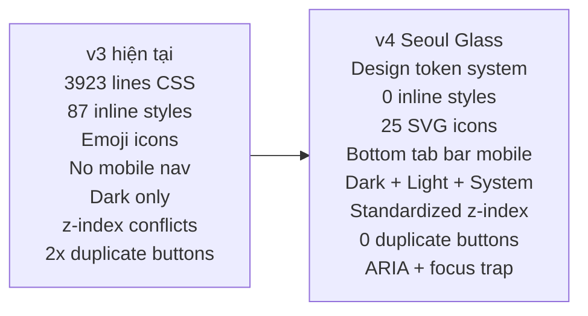

# 🎨 Korean Learning App — V4 UI Design Plan (Chi Tiết Đầy Đủ)

> **Tài liệu thiết kế giao diện phiên bản v4**
> Nâng cấp từ "Premium Dark UI" → **"Seoul Glass" Design System**
> 
> ⚠️ **CHỈ LÀ PLAN — CHƯA SỬA CODE GÌ**

---

## Mục lục

1. [Tổng quan & Triết lý thiết kế](#1-tổng-quan--triết-lý-thiết-kế)
2. [Design System mới: "Seoul Glass"](#2-design-system-mới-seoul-glass)
3. [Thiết kế lại Header & Navigation](#3-thiết-kế-lại-header--navigation)
4. [Curriculum View — Dashboard mới](#4-curriculum-view--dashboard-mới)
5. [Study Modal — Trải nghiệm học chính](#5-study-modal--trải-nghiệm-học-chính)
6. [Component Library thống nhất](#6-component-library-thống-nhất)
7. [Responsive & Mobile-First](#7-responsive--mobile-first)
8. [Micro-interactions & Animations](#8-micro-interactions--animations)
9. [Accessibility (A11y)](#9-accessibility-a11y)
10. [Dark/Light Theme](#10-darklight-theme)
11. [Sửa lỗi UI hiện tại — Danh sách đầy đủ](#11-sửa-lỗi-ui-hiện-tại--danh-sách-đầy-đủ)
12. [Kế hoạch triển khai 6 Phases](#12-kế-hoạch-triển-khai-6-phases)

---

## 1. Tổng quan & Triết lý thiết kế

### 1.1 Kiểm kê hiện trạng v3

**Files hiện tại:**

| File | Dòng | Kích thước | Vai trò |
|------|------|------------|---------|
| `index.html` | 627 | ~36KB | Single-page app, 5 views + 6 modals |
| `styles.css` | 3923 | ~118KB | Monolithic CSS, "Premium Dark UI" |
| `app.js` | 2533 | ~111KB | Main logic, navigation, CRUD, study |
| `voice.js` | — | — | TTS + Web Speech Recognition |
| `keyboard.js` | — | — | Virtual Korean keyboard |
| `recall.js` | — | — | Active Recall exercises |
| `production.js` | — | — | Production exercises |
| `anatomy.js` | — | — | Sentence anatomy parser |
| `ai.js` | — | — | Gemini AI chat + call |
| `audio-map.js` | ~2000 | ~91KB | 32 dialogues + 89 CD tracks |
| `curriculum-data.js` | — | — | SNU 1A course data |
| `sw.js` | — | — | Service Worker cache |

**Cấu trúc UI hiện tại:**

```
app-container (max-width: 1400px)
├── header.app-header (sticky, z-200, glassmorphism, 68px)
│   ├── .app-brand → logo 한 + title + subtitle
│   ├── .header-search-wrap → search input + dropdown
│   ├── .header-streak-badge → 🔥 streak count
│   ├── .header-ai-btn → ✨ AI Seoul button
│   └── nav.main-nav → 5 nav buttons (pills)
│       ├── 📚 Giáo trình (active)
│       ├── 🔔 Cần ôn + badge
│       ├── 📓 Sổ lỗi sai + badge
│       ├── 📊 Tiến độ
│       └── ⚙️ Cài đặt
│
├── main.main-content (padding: 2rem, min-height: calc(100vh - 68px))
│   ├── #curriculumView.view.active
│   │   ├── #breadcrumb
│   │   ├── #bookAiBanner (hidden khi chưa chọn book)
│   │   ├── #stageList.stage-grid
│   │   ├── #bookList.book-list.hidden
│   │   └── #lessonList.lesson-grid.hidden
│   ├── #reviewView.view
│   │   ├── .view-header → h2 "Bài cần ôn hôm nay"
│   │   ├── #reviewList.lesson-grid
│   │   └── #reviewEmpty.empty-state.hidden
│   ├── #progressView.view
│   │   ├── .view-header → h2 "Tiến độ học tập"
│   │   ├── #streakTrackerCard
│   │   ├── #statsGrid.stats-grid
│   │   └── #progressDetails
│   ├── #mistakesView.view
│   │   ├── .view-header (⚠️ INLINE STYLES trên div này)
│   │   ├── #mistakesList.lesson-grid
│   │   └── #mistakesEmpty.empty-state.hidden
│   └── #settingsView.view
│       ├── Settings: Quản lý dữ liệu
│       ├── Settings: Âm thanh & Phản hồi
│       ├── Settings: Hiển thị & Ngữ pháp
│       ├── Settings: Trí tuệ nhân tạo (Gemini)
│       └── Settings: Về ứng dụng (version 2.0 ← SAI)
│
├── #stageModal.modal (z-1000)
├── #bookModal.modal (z-1000)
├── #lessonModal.modal.modal-large (z-1000)
├── #studyModal.modal.modal-xlarge (z-1000)
│   ├── .modal-header → back btn + #studyTitle + close
│   ├── .study-body
│   │   ├── #studyProgressContainer (3-step progress bar)
│   │   ├── #nativeAudioPanel (CD player)
│   │   ├── .study-tabs → 3 tab buttons
│   │   ├── #inputTab.study-content.active
│   │   │   ├── #inputDialogueShowcase (hội thoại + luyện nghe)
│   │   │   ├── .content-box → h3 + TTS toolbar + #studyContent
│   │   │   ├── .translation-controls
│   │   │   ├── #studyNotesSection
│   │   │   └── .tab-flow-footer → "Tiếp tục: Recall →"
│   │   ├── #recallTab.study-content
│   │   │   ├── .content-box → h3 + #recallExercises
│   │   │   └── .tab-flow-footer → "← Input" + "Production →"
│   │   ├── #productionTab.study-content
│   │   │   ├── .content-box → h3 + #productionExercises
│   │   │   └── .tab-flow-footer → "← Recall" + "Hoàn thành ⭐"
│   │   ├── #reviewRating.hidden → 4 rating buttons
│   │   └── .study-footer → "← Quay lại" + "Hoàn thành" ⚠️ TRÙNG LẶP
│
├── #aiModal.modal.modal-ai-dialog (z-1000)
│   ├── .ai-modal-header → avatar + name + Chat/Call switch
│   ├── #aiChatView → messages + suggestions + input bar
│   └── #aiCallView → call screen + visualizer + controls
│
├── #floatingAudioPlayer (fixed bottom, z-999)
│
└── #rolePlayModal.modal (style="z-index:9999" ⚠️ INLINE Z-INDEX)
    ├── .roleplay-modal-header → 🎭 title + close
    └── #rolePlayModalBody (dynamic)
```

### 1.2 Bảng tổng hợp vấn đề UI hiện tại

| # | Vấn đề | File | Dòng | Mức độ |
|---|--------|------|------|--------|
| 1 | 60 inline styles trong `app.js` | `app.js` | nhiều | 🔴 Cao |
| 2 | 27 inline styles trong `index.html` | `index.html` | nhiều | 🔴 Cao |
| 3 | Emoji icons render khác nhau trên mỗi thiết bị/OS | toàn bộ | — | 🔴 Cao |
| 4 | Không có bottom nav trên mobile | `index.html` | 57-80 | 🔴 Cao |
| 5 | z-index xung đột: 9999, 2000, 1000, 999, 200 | `styles.css` + HTML | nhiều | 🟡 Trung bình |
| 6 | 2 nút "Hoàn thành" trùng lặp trong Study Modal | `index.html` | 446-449 + 478 | 🟡 Trung bình |
| 7 | `.hidden` pattern không nhất quán (class vs inline display) | `app.js` | 2256 | 🟡 Trung bình |
| 8 | 3 nút Back trùng lặp (breadcrumb + 2 inline buttons) | `app.js` | 581, 628-629 | 🟡 Trung bình |
| 9 | Version mismatch: CSS ghi "v2", Settings ghi "2.0", thực tế v3 | nhiều | 2, 209 | 🟡 Trung bình |
| 10 | Mobile ≤480px: header stack dọc chiếm quá nhiều height | `styles.css` | 602-625 | 🟡 Trung bình |
| 11 | Không có dark/light toggle | — | — | 🟡 Trung bình |
| 12 | CSS legacy variables trùng lặp (10 biến cũ) | `styles.css` | 42-56 | 🟢 Thấp |
| 13 | Book AI banner gây layout jump khi show/hide | `index.html` | 91-103 | 🟢 Thấp |
| 14 | No ARIA roles trên nav, modals, tabs | toàn bộ | — | 🟢 Thấp |
| 15 | 3923 dòng CSS monolithic, khó maintain | `styles.css` | — | 🟢 Thấp |

### 1.3 Triết lý thiết kế "Seoul Glass"

**Nguồn cảm hứng:**

- **Glassmorphism** — Frosted glass cards với `backdrop-filter: blur()`, lớp nền bán trong suốt, tạo cảm giác sâu (depth)
- **Korean aesthetics** — Khoảng trống tinh tế 여백미 (yeobaekmi — vẻ đẹp khoảng trắng), tông màu hanji paper ấm áp cho light mode
- **Apple Music** — Navigation flow mượt, cards bo tròn, spacing nhất quán
- **Linear** — Phím tắt keyboard, UI tối giản, glassmorphism
- **Duolingo** — Gamification, celebration animations, progress tracking rõ ràng

**Nguyên tắc cốt lõi:**

1. **Giữ nguyên 100% chức năng** — Không thêm, không bớt feature
2. **Glass surfaces** — Tất cả cards dùng `backdrop-filter: blur()` + semi-transparent background
3. **Consistent spacing** — 4px base unit, scale nhân 2 (4, 8, 12, 16, 20, 24, 32, 40, 48)
4. **Touch-friendly** — Minimum tap target 44×44px trên mobile, 36×36px trên desktop
5. **Theme-adaptive** — 1 bộ CSS variables, 2 bộ giá trị (dark + light), switch mượt
6. **Zero inline styles** — Mọi styling qua CSS classes, không có `style="..."` trong HTML hay JS

---

## 2. Design System mới: "Seoul Glass"

### 2.1 Color Palette — Dark Mode (Mặc định)

```css
:root,
:root[data-theme="dark"] {
    /* ── Backgrounds ── */
    /* Softer, warmer navy thay vì pure dark hiện tại */
    --bg:     #0B1120;    /* Body background — hiện tại #09101F → warm hơn nhẹ */
    --bg-s1:  #111827;    /* Card surfaces — hiện tại #0F182E → Tailwind gray-900 */
    --bg-s2:  #1F2937;    /* Hover states, inputs — hiện tại #172040 → Tailwind gray-800 */
    --bg-s3:  #374151;    /* Deep surfaces, keyboard keys — hiện tại #1E2A52 → Tailwind gray-700 */

    /* ── Glass Surfaces (MỚI) ── */
    /* Transparent layers cho glassmorphism cards */
    --glass:        rgba(255, 255, 255, 0.03);   /* Card default background */
    --glass-hover:  rgba(255, 255, 255, 0.06);   /* Card hover */
    --glass-active: rgba(255, 255, 255, 0.09);   /* Card active/pressed */
    --glass-border: rgba(255, 255, 255, 0.08);   /* Card border */

    /* ── Text Colors ── */
    /* Cải thiện contrast ratio cho accessibility */
    --tx-1: #F9FAFB;    /* Primary text — hiện tại #EEF2FF → brighter, ≥15.8:1 trên --bg */
    --tx-2: #9CA3AF;    /* Secondary text — hiện tại #94A3B8 → ≥6.3:1 trên --bg */
    --tx-3: #6B7280;    /* Muted text — hiện tại #475569 → ≥3.8:1 trên --bg */

    /* ── Accent Colors ── */
    /* Giữ indigo chủ đạo, thêm gradient tông violet */
    --accent:        #818CF8;    /* Primary accent — GIỮ NGUYÊN */
    --accent-bright: #A78BFA;    /* Active states — thay #A5B4FC → tông violet hơn */
    --accent-dark:   #4F46E5;    /* Gradients, deep accent — GIỮ NGUYÊN */
    --accent-soft:   rgba(129, 140, 248, 0.15);   /* Thay --accent-glow → tên rõ hơn */
    --accent-glow:   rgba(129, 140, 248, 0.25);   /* Glow effects (stronger) */

    /* ── Accent Secondary ── */
    --accent-cyan:   #22D3EE;    /* GIỮ NGUYÊN — dùng cho Recall tab */
    --accent-green:  #34D399;    /* Dùng cho Production tab (đổi tên từ --success) */
    --accent-amber:  #FBBF24;    /* Dùng cho streak, due items (đổi tên từ --warning) */

    /* ── Semantic Colors ── */
    --success:     #34D399;    /* Correct answers, studied status */
    --success-bg:  rgba(52, 211, 153, 0.1);
    --success-text: #6EE7B7;   /* MỚI — text trên success-bg cho readability */

    --warning:     #FBBF24;    /* Due/review items, streak fire */
    --warning-bg:  rgba(251, 191, 36, 0.1);
    --warning-text: #FDE68A;   /* MỚI */

    --danger:      #F87171;    /* Errors, wrong answers, delete */
    --danger-bg:   rgba(248, 113, 113, 0.1);
    --danger-text: #FCA5A5;    /* MỚI */

    /* ── Borders ── */
    --border:       rgba(129, 140, 248, 0.1);    /* GIỮ NGUYÊN */
    --border-hover: rgba(129, 140, 248, 0.28);   /* GIỮ NGUYÊN */
    --border-focus: rgba(129, 140, 248, 0.5);    /* MỚI — focus ring */

    /* ── Border Radius ── */
    --radius-xs:    4px;     /* Badges nhỏ */
    --radius-sm:    8px;     /* Buttons, inputs, tags */
    --radius-md:   12px;     /* Cards thường */
    --radius-lg:   16px;     /* Modal content, lớn hơn */
    --radius-xl:   24px;     /* Hero cards, containers */
    --radius-full: 9999px;   /* Pills, avatars, nav badges */

    /* ── Shadows ── */
    --shadow-xs:   0 1px 2px rgba(0, 0, 0, 0.3);
    --shadow-sm:   0 1px 4px rgba(0, 0, 0, 0.4);
    --shadow-md:   0 4px 16px rgba(0, 0, 0, 0.45);
    --shadow-lg:   0 8px 32px rgba(0, 0, 0, 0.5);
    --shadow-xl:   0 16px 48px rgba(0, 0, 0, 0.6);
    --shadow-glow: 0 0 24px var(--accent-soft);
    --shadow-glow-strong: 0 0 40px var(--accent-glow);

    /* ── Z-Index Layers ── */
    --z-base:      0;      /* Normal content */
    --z-sticky:    100;    /* Sticky header */
    --z-dropdown:  200;    /* Search dropdown, context menus */
    --z-floating:  300;    /* Floating audio player, FABs */
    --z-modal:     400;    /* All modals (stage, book, lesson, study, AI) */
    --z-overlay:   500;    /* Modal overlay backdrop */
    --z-toast:     600;    /* Toast notifications */
    --z-keyboard:  700;    /* Virtual keyboard */
    --z-critical:  900;    /* Role-play (topmost modal) */
}
```

### 2.2 Color Palette — Light Mode

```css
:root[data-theme="light"] {
    /* ── Backgrounds ── */
    /* Warm off-white tones, lấy cảm hứng từ hanji paper Hàn Quốc */
    --bg:     #FAFAF9;    /* Body background — warm stone-50 */
    --bg-s1:  #FFFFFF;    /* Card surfaces — pure white */
    --bg-s2:  #F5F5F4;    /* Hover states, inputs — stone-100 */
    --bg-s3:  #E7E5E4;    /* Deep surfaces, keyboard keys — stone-200 */

    /* ── Glass Surfaces ── */
    --glass:        rgba(255, 255, 255, 0.7);
    --glass-hover:  rgba(255, 255, 255, 0.85);
    --glass-active: rgba(255, 255, 255, 0.95);
    --glass-border: rgba(0, 0, 0, 0.08);

    /* ── Text Colors ── */
    --tx-1: #1C1917;    /* Primary text — stone-900 */
    --tx-2: #57534E;    /* Secondary text — stone-600 */
    --tx-3: #A8A29E;    /* Muted text — stone-400 */

    /* ── Accent Colors ── */
    /* Deeper cho contrast trên nền sáng */
    --accent:        #6366F1;    /* Indigo-500 (deeper) */
    --accent-bright: #818CF8;    /* Indigo-400 */
    --accent-dark:   #4338CA;    /* Indigo-700 */
    --accent-soft:   rgba(99, 102, 241, 0.1);
    --accent-glow:   rgba(99, 102, 241, 0.15);

    /* ── Accent Secondary ── */
    --accent-cyan:   #0891B2;    /* Cyan-600 (darker) */
    --accent-green:  #059669;    /* Emerald-600 */
    --accent-amber:  #D97706;    /* Amber-600 */

    /* ── Semantic Colors ── */
    --success:      #059669;
    --success-bg:   rgba(5, 150, 105, 0.08);
    --success-text: #047857;

    --warning:      #D97706;
    --warning-bg:   rgba(217, 119, 6, 0.08);
    --warning-text: #B45309;

    --danger:       #DC2626;
    --danger-bg:    rgba(220, 38, 38, 0.06);
    --danger-text:  #B91C1C;

    /* ── Borders ── */
    --border:       rgba(0, 0, 0, 0.08);
    --border-hover: rgba(0, 0, 0, 0.15);
    --border-focus: rgba(99, 102, 241, 0.5);

    /* ── Shadows ── */
    /* Nhẹ hơn dark mode */
    --shadow-xs:   0 1px 2px rgba(0, 0, 0, 0.04);
    --shadow-sm:   0 1px 3px rgba(0, 0, 0, 0.06);
    --shadow-md:   0 4px 12px rgba(0, 0, 0, 0.08);
    --shadow-lg:   0 8px 24px rgba(0, 0, 0, 0.1);
    --shadow-xl:   0 16px 40px rgba(0, 0, 0, 0.12);
    --shadow-glow: 0 0 16px var(--accent-soft);
    --shadow-glow-strong: 0 0 32px var(--accent-glow);
}
```

### 2.3 Typography Scale

```css
:root {
    /* ── Font Families ── */
    --font-ui:   'Inter', -apple-system, BlinkMacSystemFont, 'Segoe UI', sans-serif;
    --font-kr:   'Noto Sans KR', 'Apple SD Gothic Neo', 'Malgun Gothic', sans-serif;
    --font-mono: 'JetBrains Mono', 'Fira Code', 'Consolas', monospace;

    /* ── Type Scale (Modular scale 1.25 — Major Third) ── */
    --text-2xs:  0.625rem;   /* 10px — micro labels, keyboard hints */
    --text-xs:   0.75rem;    /* 12px — badges, pill labels, timestamps */
    --text-sm:   0.875rem;   /* 14px — secondary text, card descriptions */
    --text-base: 1rem;       /* 16px — body text, form inputs */
    --text-lg:   1.125rem;   /* 18px — card titles, section labels */
    --text-xl:   1.25rem;    /* 20px — section headers, modal titles */
    --text-2xl:  1.5rem;     /* 24px — page titles, view headers */
    --text-3xl:  1.875rem;   /* 30px — hero numbers, stat values */
    --text-4xl:  2.25rem;    /* 36px — Korean study text (large display) */

    /* ── Font Weights ── */
    --weight-normal:   400;
    --weight-medium:   500;
    --weight-semibold: 600;
    --weight-bold:     700;

    /* ── Line Heights ── */
    --leading-none:    1;       /* Numbers, badges */
    --leading-tight:   1.25;    /* Headings */
    --leading-snug:    1.375;   /* Card titles */
    --leading-normal:  1.5;     /* Body text */
    --leading-relaxed: 1.75;    /* Korean text — Hangul cần thêm breathing room */
    --leading-loose:   2;       /* Study items with inline translations */

    /* ── Letter Spacing ── */
    --tracking-tight:  -0.025em;   /* Headings */
    --tracking-normal: 0;          /* Body */
    --tracking-wide:   0.05em;     /* Badges, labels */
    --tracking-wider:  0.1em;      /* Uppercase labels */
}
```

### 2.4 Spacing System

```css
:root {
    /* ── Base unit: 4px, scale ×2 ── */
    --space-0:   0;
    --space-px:  1px;
    --space-0.5: 0.125rem;  /* 2px */
    --space-1:   0.25rem;   /* 4px */
    --space-1.5: 0.375rem;  /* 6px */
    --space-2:   0.5rem;    /* 8px */
    --space-2.5: 0.625rem;  /* 10px */
    --space-3:   0.75rem;   /* 12px */
    --space-4:   1rem;      /* 16px */
    --space-5:   1.25rem;   /* 20px */
    --space-6:   1.5rem;    /* 24px */
    --space-8:   2rem;      /* 32px */
    --space-10:  2.5rem;    /* 40px */
    --space-12:  3rem;      /* 48px */
    --space-16:  4rem;      /* 64px */
    --space-20:  5rem;      /* 80px */
}
```

### 2.5 Z-Index System chuẩn hóa

**Hiện tại (v3) — xung đột:**

| Element | z-index hiện tại | Vấn đề |
|---------|-------------------|--------|
| `.app-header` | 200 | OK |
| `#floatingAudioPlayer` | 999 | Chồng lấn với modals |
| `.modal` (tất cả) | 1000 | Keyboard cũng 1000 → chồng |
| `.virtual-keyboard` | 1000 | Trùng modals |
| `#rolePlayModal` CSS | 2000 | Khác với inline |
| `#rolePlayModal` inline HTML | 9999 | Inline thắng → nhưng không nhất quán |

**Mới (v4) — phân tầng rõ ràng:**

| Element | z-index mới | CSS Variable |
|---------|-------------|-------------|
| Normal content | 0 | `--z-base` |
| Header (sticky) | 100 | `--z-sticky` |
| Search dropdown | 200 | `--z-dropdown` |
| Floating audio player | 300 | `--z-floating` |
| Virtual keyboard FAB | 300 | `--z-floating` |
| All modals (stage, book, lesson, study, AI) | 400 | `--z-modal` |
| Modal overlay backdrop | 500 | `--z-overlay` |
| Toast notifications (tương lai) | 600 | `--z-toast` |
| Virtual keyboard panel | 700 | `--z-keyboard` |
| Role-play modal (topmost) | 900 | `--z-critical` |

---

## 3. Thiết kế lại Header & Navigation

### 3.1 Desktop Header (≥ 768px) — 2-row layout

**Hiện tại:**
```
┌──────────────────────────────────────────────────────────────────┐
│ [한] Học Tiếng Hàn │ [🔍 Search...] │ 🔥12 │ ✨AI │ 📚│🔔│📓│📊│⚙️│
│    Active Recall   │                 │ ngày │Seoul │                │
└──────────────────────────────────────────────────────────────────┘
← Tất cả 1 hàng, quá chật, mobile bị vỡ →
```

**Mới:**
```
┌──────────────────────────────────────────────────────────────────┐
│  Row 1:  [한] Học Tiếng Hàn    [🔍 Search ⌘F...]    🔥 12  [✨] │
├──────────────────────────────────────────────────────────────────┤
│  Row 2:  ──Giáo trình── ──Cần ôn (3)── ──Tiến độ── ──Cài đặt──│
│                ▬▬▬▬                                              │
│          (underline active indicator)                            │
└──────────────────────────────────────────────────────────────────┘
```

**HTML mới (đề xuất):**

```html
<header class="app-header">
    <!-- Row 1: Brand + Actions -->
    <div class="header-row-top">
        <div class="app-brand">
            <span class="app-logo">한</span>
            <h1 class="app-title">Học Tiếng Hàn</h1>
        </div>

        <div class="header-search-wrap">
            <svg class="icon-search"><!-- Lucide search SVG --></svg>
            <input type="text" id="globalSearchInput"
                   placeholder="Tìm kiếm từ vựng, bài học... (⌘F)"
                   autocomplete="off">
            <button type="button" id="clearSearchBtn"
                    class="btn-icon hidden"
                    onclick="clearGlobalSearch()">
                <svg class="icon-x"><!-- Lucide x SVG --></svg>
            </button>
        </div>
        <div id="searchResultsDropdown" class="search-dropdown hidden"></div>

        <div class="header-actions">
            <div class="streak-badge" id="headerStreak"
                 onclick="showStreakTab()"
                 title="Chuỗi ngày học liên tục">
                🔥 <span id="headerStreakCount">0</span>
            </div>

            <button type="button" class="btn-icon btn-ai"
                    onclick="openGlobalAIBot('call')"
                    title="AI Seoul · Trò chuyện tiếng Hàn">
                <svg class="icon-sparkles"><!-- SVG --></svg>
            </button>

            <button type="button" class="btn-icon btn-theme"
                    onclick="toggleTheme()"
                    title="Chuyển sáng/tối">
                <svg class="icon-sun-moon"><!-- SVG --></svg>
            </button>
        </div>
    </div>

    <!-- Row 2: Navigation Tabs -->
    <nav class="header-nav" aria-label="Điều hướng chính" role="tablist">
        <button class="nav-tab active" data-view="curriculum"
                role="tab" aria-selected="true" aria-controls="curriculumView">
            <svg class="icon-book-open"><!-- SVG --></svg>
            <span>Giáo trình</span>
        </button>
        <button class="nav-tab" data-view="review"
                role="tab" aria-selected="false" aria-controls="reviewView">
            <svg class="icon-bell"><!-- SVG --></svg>
            <span>Cần ôn</span>
            <span class="nav-badge" id="reviewCount">0</span>
        </button>
        <button class="nav-tab" data-view="progress"
                role="tab" aria-selected="false" aria-controls="progressView">
            <svg class="icon-bar-chart"><!-- SVG --></svg>
            <span>Tiến độ</span>
        </button>
        <button class="nav-tab" data-view="settings"
                role="tab" aria-selected="false" aria-controls="settingsView">
            <svg class="icon-settings"><!-- SVG --></svg>
            <span>Cài đặt</span>
        </button>
    </nav>
</header>
```

**Thay đổi cụ thể:**
- **Bỏ subtitle** "Active Recall Edition" — không cần thiết, chiếm space
- **2-row layout** — Row 1 compact (brand + search + actions), Row 2 navigation
- **Tab underline** thay pills — sạch hơn, underline indicator trượt mượt dưới active tab
- **4 nav items** thay 5 — Gộp "Sổ lỗi sai" vào trong "Tiến độ" view thành 1 section
- **Theme toggle button** — Thêm mới, icon sun/moon
- **SVG icons** thay tất cả emoji trong header

**CSS cho desktop header:**

```css
.app-header {
    position: sticky;
    top: 0;
    z-index: var(--z-sticky);
    background: rgba(11, 17, 32, 0.82);
    backdrop-filter: blur(24px) saturate(180%);
    -webkit-backdrop-filter: blur(24px) saturate(180%);
    border-bottom: 1px solid var(--glass-border);
}

.header-row-top {
    display: flex;
    align-items: center;
    gap: var(--space-4);
    padding: var(--space-3) var(--space-6);
    max-width: 1400px;
    margin: 0 auto;
}

.header-nav {
    display: flex;
    gap: 0;
    max-width: 1400px;
    margin: 0 auto;
    padding: 0 var(--space-6);
    border-top: 1px solid var(--glass-border);
}

.nav-tab {
    position: relative;
    display: inline-flex;
    align-items: center;
    gap: var(--space-2);
    padding: var(--space-3) var(--space-5);
    background: none;
    border: none;
    color: var(--tx-2);
    font-size: var(--text-sm);
    font-weight: var(--weight-medium);
    cursor: pointer;
    transition: color 0.2s ease;
}

.nav-tab:hover {
    color: var(--tx-1);
}

.nav-tab.active {
    color: var(--accent);
}

/* Underline indicator — animated */
.nav-tab.active::after {
    content: '';
    position: absolute;
    bottom: 0;
    left: var(--space-5);
    right: var(--space-5);
    height: 2px;
    background: var(--accent);
    border-radius: var(--radius-full);
    animation: tab-underline-enter 0.2s ease;
}

@keyframes tab-underline-enter {
    from { transform: scaleX(0); }
    to   { transform: scaleX(1); }
}

.nav-badge {
    display: inline-flex;
    align-items: center;
    justify-content: center;
    min-width: 18px;
    height: 18px;
    padding: 0 5px;
    border-radius: var(--radius-full);
    background: var(--danger);
    color: white;
    font-size: var(--text-2xs);
    font-weight: var(--weight-bold);
}
.nav-badge:empty {
    display: none;
}
```

### 3.2 Mobile Bottom Navigation (< 768px)

**HTML mới — bottom-nav (render bằng JS khi mobile):**

```html
<!-- Thêm vào cuối body, trước script tags -->
<nav class="bottom-nav" id="bottomNav" aria-label="Điều hướng chính (mobile)">
    <button class="bottom-nav-item active" data-view="curriculum">
        <svg class="icon-book-open"><!-- SVG --></svg>
        <span>Giáo trình</span>
    </button>
    <button class="bottom-nav-item" data-view="review">
        <svg class="icon-bell"><!-- SVG --></svg>
        <span>Cần ôn</span>
        <span class="bottom-nav-badge" id="reviewCountMobile">0</span>
    </button>
    <button class="bottom-nav-item" data-view="progress">
        <svg class="icon-bar-chart"><!-- SVG --></svg>
        <span>Tiến độ</span>
    </button>
    <button class="bottom-nav-item" data-view="settings">
        <svg class="icon-settings"><!-- SVG --></svg>
        <span>Cài đặt</span>
    </button>
</nav>
```

**CSS cho bottom nav:**

```css
/* Chỉ hiện trên mobile */
.bottom-nav {
    display: none;
}

@media (max-width: 767px) {
    /* Ẩn header nav row trên mobile */
    .header-nav {
        display: none;
    }

    /* Hiện bottom nav */
    .bottom-nav {
        display: flex;
        position: fixed;
        bottom: 0;
        left: 0;
        right: 0;
        z-index: var(--z-sticky);
        background: rgba(11, 17, 32, 0.92);
        backdrop-filter: blur(24px) saturate(180%);
        -webkit-backdrop-filter: blur(24px) saturate(180%);
        border-top: 1px solid var(--glass-border);
        /* Safe area cho iPhone notch */
        padding-bottom: env(safe-area-inset-bottom, 0);
    }

    .bottom-nav-item {
        flex: 1;
        display: flex;
        flex-direction: column;
        align-items: center;
        gap: 2px;
        padding: var(--space-2) var(--space-1);
        background: none;
        border: none;
        color: var(--tx-3);
        font-size: var(--text-2xs);
        font-weight: var(--weight-medium);
        cursor: pointer;
        transition: color 0.15s ease;
        position: relative;
    }

    .bottom-nav-item svg {
        width: 22px;
        height: 22px;
        stroke-width: 1.5;
    }

    .bottom-nav-item.active {
        color: var(--accent);
    }

    /* Active dot indicator */
    .bottom-nav-item.active::before {
        content: '';
        position: absolute;
        top: 2px;
        width: 4px;
        height: 4px;
        border-radius: 50%;
        background: var(--accent);
    }

    .bottom-nav-badge {
        position: absolute;
        top: 2px;
        right: calc(50% - 16px);
        min-width: 14px;
        height: 14px;
        padding: 0 4px;
        border-radius: var(--radius-full);
        background: var(--danger);
        color: white;
        font-size: 9px;
        font-weight: var(--weight-bold);
        display: flex;
        align-items: center;
        justify-content: center;
    }
    .bottom-nav-badge:empty {
        display: none;
    }

    /* Thêm padding-bottom cho main content, tránh bị bottom-nav che */
    .main-content {
        padding-bottom: calc(60px + env(safe-area-inset-bottom, 0));
    }

    /* Mobile header chỉ giữ brand + actions (compact) */
    .header-row-top {
        padding: var(--space-2) var(--space-4);
    }

    .header-search-wrap {
        display: none;
        /* Search sẽ mở full-screen overlay khi tap icon */
    }
}
```

### 3.3 Icon System — Emoji → SVG (Danh sách đầy đủ)

Tạo file `icons.js` chứa tất cả SVG icons dưới dạng functions. Mỗi icon trả về SVG string, có thể style bằng CSS `color` và `width/height`.

**Bảng mapping đầy đủ:**

| # | Vị trí | Emoji hiện tại | SVG Icon mới (Lucide) | Lý do thay |
|---|--------|----------------|----------------------|------------|
| 1 | Header search | 🔍 | `<Search />` | Crisp, tintable |
| 2 | Nav: Giáo trình | 📚 | `<BookOpen />` | Consistent stroke |
| 3 | Nav: Cần ôn | 🔔 | `<Bell />` | Có thể animate dot |
| 4 | Nav: Sổ lỗi sai | 📓 | `<BookX />` | Phân biệt với 📚 |
| 5 | Nav: Tiến độ | 📊 | `<BarChart3 />` | Clean rendering |
| 6 | Nav: Cài đặt | ⚙️ | `<Settings />` | Thống nhất stroke |
| 7 | Header AI button | ✨ | `<Sparkles />` | Controlled animation |
| 8 | Header AI pulse | (CSS dot) | `<Sparkles />` animated | Giữ nguyên |
| 9 | Streak flame | 🔥 | **GIỮ EMOJI 🔥** | Streak fire emoji expressive hơn SVG |
| 10 | CD Audio badge | 💿 | `<Disc3 />` | Quay mượt hơn |
| 11 | TTS speaker | 🔊 | `<Volume2 />` | Tintable |
| 12 | Mic button | 🎙️ | `<Mic />` | Animate khi recording |
| 13 | Play/Pause | ▶️ / ⏸️ | `<Play />` / `<Pause />` | Crisp, no emoji skin |
| 14 | Stop | ⏹️ | `<Square />` | Consistent size |
| 15 | Skip back | ⏪ | `<SkipBack />` | Clean |
| 16 | Skip forward | ⏩ | `<SkipForward />` | Clean |
| 17 | Close/X buttons | ✕ / × | `<X />` | Uniform across modals |
| 18 | Back arrow | ← | `<ArrowLeft />` | Consistent weight |
| 19 | Empty state ✅ | ✅ | `<CheckCircle2 />` | Tintable |
| 20 | Empty state 🎉 | 🎉 | **GIỮ EMOJI 🎉** | Celebration — emoji tốt hơn |
| 21 | Keyboard button | ⌨️ | `<Keyboard />` | Size nhất quán |
| 22 | Role-play | 🎭 | **GIỮ EMOJI 🎭** | Expressive, context-specific |
| 23 | Settings export | 📥 | `<Download />` | Clean |
| 24 | Settings import | 📤 | `<Upload />` | Clean |
| 25 | Settings delete | 🗑️ | `<Trash2 />` | Tintable danger red |
| 26 | Settings save | 💾 | `<Save />` | Clean |
| 27 | Call phone | 📞 | `<Phone />` | Animate |
| 28 | Chat | 💬 | `<MessageCircle />` | Clean |
| 29 | Eye toggle | 👁️ | `<Eye />` / `<EyeOff />` | State-aware |
| 30 | Add/Plus | ➕ | `<Plus />` | Consistent |
| 31 | Flag VN | 🇻🇳 | **GIỮ EMOJI 🇻🇳** | Flag emoji universal |
| 32 | Flag UK | 🇬🇧 | **GIỮ EMOJI 🇬🇧** | Flag emoji universal |
| 33 | Flag KR | 🇰🇷 | **GIỮ EMOJI 🇰🇷** | Flag emoji universal |

**Tóm tắt**: Thay 25 emoji → SVG, giữ 8 emoji (🔥 🎉 🎭 🇻🇳 🇬🇧 🇰🇷 + các emoji trong nội dung học).

**Cấu trúc file `icons.js`:**

```js
// icons.js — Seoul Glass Icon System
// Lucide Icons (ISC License) — https://lucide.dev
window.Icons = {
    // Trả về SVG string, inject vào innerHTML
    // size default 20px, có thể override bằng CSS
    search: (size = 20) => `<svg xmlns="http://www.w3.org/2000/svg" width="${size}" height="${size}" viewBox="0 0 24 24" fill="none" stroke="currentColor" stroke-width="2" stroke-linecap="round" stroke-linejoin="round"><circle cx="11" cy="11" r="8"/><path d="m21 21-4.3-4.3"/></svg>`,

    bookOpen: (size = 20) => `<svg ...>...</svg>`,
    bell:     (size = 20) => `<svg ...>...</svg>`,
    barChart: (size = 20) => `<svg ...>...</svg>`,
    settings: (size = 20) => `<svg ...>...</svg>`,
    sparkles: (size = 20) => `<svg ...>...</svg>`,
    disc:     (size = 20) => `<svg ...>...</svg>`,
    volume2:  (size = 20) => `<svg ...>...</svg>`,
    mic:      (size = 20) => `<svg ...>...</svg>`,
    play:     (size = 20) => `<svg ...>...</svg>`,
    pause:    (size = 20) => `<svg ...>...</svg>`,
    square:   (size = 20) => `<svg ...>...</svg>`,
    skipBack: (size = 20) => `<svg ...>...</svg>`,
    skipFwd:  (size = 20) => `<svg ...>...</svg>`,
    x:        (size = 20) => `<svg ...>...</svg>`,
    arrowLeft:(size = 20) => `<svg ...>...</svg>`,
    checkCircle: (size = 20) => `<svg ...>...</svg>`,
    keyboard: (size = 20) => `<svg ...>...</svg>`,
    download: (size = 20) => `<svg ...>...</svg>`,
    upload:   (size = 20) => `<svg ...>...</svg>`,
    trash:    (size = 20) => `<svg ...>...</svg>`,
    save:     (size = 20) => `<svg ...>...</svg>`,
    phone:    (size = 20) => `<svg ...>...</svg>`,
    messageCircle: (size = 20) => `<svg ...>...</svg>`,
    eye:      (size = 20) => `<svg ...>...</svg>`,
    eyeOff:   (size = 20) => `<svg ...>...</svg>`,
    plus:     (size = 20) => `<svg ...>...</svg>`,
    sunMoon:  (size = 20) => `<svg ...>...</svg>`,
};

// Helper function
function icon(name, size) {
    return Icons[name] ? Icons[name](size) : '';
}
```

---

## 4. Curriculum View — Dashboard mới

### 4.1 Layout tổng thể

```
┌──────────────────────────────────────────────────────────┐
│                    HEADER (2 rows)                        │
├──────────────────────────────────────────────────────────┤
│                                                          │
│  ┌─ Hero Card ───────────────────────────────────────┐   │
│  │                                                   │   │
│  │  📖 Tiếp tục học                                  │   │
│  │                                                   │   │
│  │  Bài 5: 위치 · Vị trí                             │   │
│  │  ████████████░░░░░  72%                           │   │
│  │  20/28 từ đã thuộc · Ôn lại sau 2 ngày           │   │
│  │                                                   │   │
│  │                                    [▶ Học tiếp]   │   │
│  │                                                   │   │
│  └───────────────────────────────────────────────────┘   │
│                                                          │
│  ┌──────────┐  ┌──────────┐  ┌───────────┐              │
│  │ 🔥 12    │  │ ✅ 85    │  │ 🔔 3      │              │
│  │ ngày     │  │ từ thuộc │  │ bài ôn    │              │
│  │ streak   │  │          │  │           │              │
│  └──────────┘  └──────────┘  └───────────┘              │
│                                                          │
│  ── Giáo trình SNU 서울대 한국어 1A ──────────────────── │
│                                                          │
│  ┌────────────┐  ┌────────────┐  ┌────────────┐         │
│  │         •••│  │         •••│  │         •••│         │
│  │  1         │  │  2         │  │  3         │         │
│  │  인사       │  │  일상       │  │  날짜와 요일 │         │
│  │  Chào hỏi  │  │  Cuộc sống │  │  Ngày tháng │         │
│  │            │  │  hàng ngày │  │  thứ        │         │
│  │ ████████░░ │  │ ██████░░░░ │  │ ████░░░░░░ │         │
│  │ 80% · ✓   │  │ 60%        │  │ 40%        │         │
│  │ 28 từ     │  │ 28 từ      │  │ 28 từ      │         │
│  └────────────┘  └────────────┘  └────────────┘         │
│                                                          │
│  ┌────────────┐  ┌────────────┐  ┌────────────┐         │
│  │         •••│  │         •••│  │         •••│         │
│  │  4         │  │  5         │  │  6         │         │
│  │  위치       │  │  하루 일과  │  │  물건 사기   │         │
│  │  Vị trí    │  │  Công việc │  │  Mua sắm   │         │
│  │            │  │  hàng ngày │  │            │         │
│  │ ██░░░░░░░░ │  │ ░░░░░░░░░░ │  │ ░░░░░░░░░░ │         │
│  │ 20%        │  │ 0% · MỚI  │  │ 0% · MỚI  │         │
│  │ 28 từ     │  │ 28 từ      │  │ 28 từ      │         │
│  └────────────┘  └────────────┘  └────────────┘         │
│                                                          │
│  ┌────────────┐  ┌────────────┐                          │
│  │         •••│  │         •••│                          │
│  │  7         │  │  8         │                          │
│  │  교통       │  │  전화       │                          │
│  │  Giao thông│  │  Điện thoại│                          │
│  │            │  │            │                          │
│  │ ░░░░░░░░░░ │  │ ░░░░░░░░░░ │                          │
│  │ 0% · MỚI  │  │ 0% · MỚI  │                          │
│  │ 28 từ     │  │ 28 từ      │                          │
│  └────────────┘  └────────────┘                          │
│                                                          │
└──────────────────────────────────────────────────────────┘
```

### 4.2 Hero "Continue Learning" Card

**Logic xác định bài hiển thị:**
1. Ưu tiên 1: Bài có `due date` đã đến hoặc quá hạn (cần ôn gấp nhất)
2. Ưu tiên 2: Bài đã bắt đầu học nhưng chưa hoàn thành 100%
3. Ưu tiên 3: Bài mới tiếp theo theo thứ tự giáo trình (chưa từng mở)
4. Nếu tất cả đã hoàn thành 100% → hiện card "Chúc mừng! Bạn đã học xong tất cả bài"

**CSS:**

```css
.hero-card {
    background: linear-gradient(135deg,
        rgba(99, 102, 241, 0.15) 0%,
        rgba(139, 92, 246, 0.1) 50%,
        rgba(34, 211, 238, 0.05) 100%
    );
    border: 1px solid var(--accent-soft);
    border-radius: var(--radius-xl);
    padding: var(--space-8) var(--space-6);
    margin-bottom: var(--space-6);
    position: relative;
    overflow: hidden;
}

/* Decorative glow blob behind card */
.hero-card::before {
    content: '';
    position: absolute;
    top: -50%;
    right: -20%;
    width: 300px;
    height: 300px;
    background: radial-gradient(circle, var(--accent-soft) 0%, transparent 70%);
    border-radius: 50%;
    pointer-events: none;
}

.hero-card-label {
    font-size: var(--text-xs);
    font-weight: var(--weight-semibold);
    color: var(--accent-bright);
    text-transform: uppercase;
    letter-spacing: var(--tracking-wider);
    margin-bottom: var(--space-3);
}

.hero-card-title {
    font-size: var(--text-2xl);
    font-weight: var(--weight-bold);
    color: var(--tx-1);
    margin-bottom: var(--space-2);
    line-height: var(--leading-tight);
}

.hero-card-korean {
    font-family: var(--font-kr);
    font-size: var(--text-xl);
    color: var(--tx-2);
    margin-bottom: var(--space-4);
}

.hero-card-progress {
    display: flex;
    align-items: center;
    gap: var(--space-3);
    margin-bottom: var(--space-3);
}

.hero-card-progress-bar {
    flex: 1;
    height: 6px;
    background: var(--glass-border);
    border-radius: var(--radius-full);
    overflow: hidden;
}

.hero-card-progress-fill {
    height: 100%;
    background: linear-gradient(90deg, var(--accent), var(--accent-bright));
    border-radius: var(--radius-full);
    transition: width 0.5s cubic-bezier(0.34, 1.56, 0.64, 1);
}

.hero-card-meta {
    font-size: var(--text-sm);
    color: var(--tx-2);
    margin-bottom: var(--space-5);
}

.hero-card-cta {
    display: inline-flex;
    align-items: center;
    gap: var(--space-2);
    padding: var(--space-3) var(--space-6);
    background: linear-gradient(135deg, var(--accent-dark), var(--accent));
    color: white;
    border: none;
    border-radius: var(--radius-sm);
    font-size: var(--text-base);
    font-weight: var(--weight-semibold);
    cursor: pointer;
    transition: all 0.2s ease;
    box-shadow: 0 2px 12px var(--accent-soft);
}

.hero-card-cta:hover {
    transform: translateY(-2px);
    box-shadow: 0 4px 20px var(--accent-glow);
}
```

### 4.3 Quick Stats Bar

```css
.quick-stats {
    display: grid;
    grid-template-columns: repeat(3, 1fr);
    gap: var(--space-4);
    margin-bottom: var(--space-8);
}

.quick-stat {
    display: flex;
    flex-direction: column;
    align-items: center;
    padding: var(--space-4) var(--space-3);
    background: var(--glass);
    border: 1px solid var(--glass-border);
    border-radius: var(--radius-md);
    cursor: pointer;
    transition: all 0.2s ease;
}

.quick-stat:hover {
    background: var(--glass-hover);
    transform: translateY(-2px);
}

.quick-stat-value {
    font-size: var(--text-3xl);
    font-weight: 800;
    line-height: var(--leading-none);
    margin-bottom: var(--space-1);
}

.quick-stat-value.streak { color: var(--accent-amber); }
.quick-stat-value.studied { color: var(--success); }
.quick-stat-value.due { color: var(--danger); }

.quick-stat-label {
    font-size: var(--text-xs);
    color: var(--tx-3);
    font-weight: var(--weight-medium);
}
```

### 4.4 Lesson Cards — 4 trạng thái đầy đủ

**Trạng thái 1: Chưa học (MỚI)**
```css
.lesson-card.state-new {
    border: 1px solid var(--glass-border);
    background: var(--glass);
}
.lesson-card.state-new .lesson-card-badge {
    background: var(--bg-s2);
    color: var(--tx-3);
}
.lesson-card.state-new .lesson-card-badge::after {
    content: 'MỚI';
}
```

**Trạng thái 2: Đang học (IN PROGRESS)**
```css
.lesson-card.state-learning {
    border-left: 3px solid var(--accent);
    background: var(--glass);
}
.lesson-card.state-learning .lesson-card-badge {
    background: var(--accent-soft);
    color: var(--accent-bright);
}
```

**Trạng thái 3: Đã thuộc (MASTERED)**
```css
.lesson-card.state-mastered {
    border-left: 3px solid var(--success);
    background: var(--glass);
}
.lesson-card.state-mastered .lesson-card-badge {
    background: var(--success-bg);
    color: var(--success);
}
.lesson-card.state-mastered .lesson-card-badge::after {
    content: '✓';
    margin-left: 4px;
}
```

**Trạng thái 4: Cần ôn (DUE)**
```css
.lesson-card.state-due {
    border-left: 3px solid var(--warning);
    background: var(--glass);
    animation: due-pulse 3s infinite;
}
@keyframes due-pulse {
    0%, 100% { box-shadow: none; }
    50% { box-shadow: 0 0 12px var(--warning-bg); }
}
.lesson-card.state-due .lesson-card-badge {
    background: var(--warning-bg);
    color: var(--warning);
}
```

**CSS chung cho tất cả lesson cards:**

```css
.lesson-card {
    position: relative;
    padding: var(--space-5);
    background: var(--glass);
    border: 1px solid var(--glass-border);
    border-radius: var(--radius-md);
    cursor: pointer;
    transition: all 0.2s ease;
}

.lesson-card:hover {
    background: var(--glass-hover);
    border-color: var(--accent-soft);
    transform: translateY(-2px);
    box-shadow: var(--shadow-md);
}

.lesson-card-header {
    display: flex;
    justify-content: space-between;
    align-items: flex-start;
    margin-bottom: var(--space-2);
}

.lesson-card-number {
    font-size: var(--text-3xl);
    font-weight: 800;
    color: var(--tx-3);
    opacity: 0.5;
    line-height: var(--leading-none);
}

/* Context menu (thay thế edit/delete buttons luôn hiện) */
.lesson-card-menu {
    width: 28px;
    height: 28px;
    display: flex;
    align-items: center;
    justify-content: center;
    border-radius: var(--radius-sm);
    background: none;
    border: none;
    color: var(--tx-3);
    cursor: pointer;
    opacity: 0;
    transition: opacity 0.15s ease;
}
.lesson-card:hover .lesson-card-menu {
    opacity: 1;
}
.lesson-card-menu:hover {
    background: var(--glass-hover);
    color: var(--tx-1);
}

.lesson-card-title {
    font-family: var(--font-kr);
    font-size: var(--text-lg);
    font-weight: var(--weight-bold);
    color: var(--tx-1);
    line-height: var(--leading-snug);
    margin-bottom: var(--space-1);
}

.lesson-card-subtitle {
    font-size: var(--text-sm);
    color: var(--tx-2);
    margin-bottom: var(--space-4);
}

.lesson-card-progress {
    height: 4px;
    background: var(--glass-border);
    border-radius: var(--radius-full);
    overflow: hidden;
    margin-bottom: var(--space-2);
}

.lesson-card-progress-fill {
    height: 100%;
    border-radius: var(--radius-full);
    background: linear-gradient(90deg, var(--accent), var(--accent-bright));
    transition: width 0.3s ease;
}

.lesson-card-meta {
    display: flex;
    justify-content: space-between;
    align-items: center;
    font-size: var(--text-xs);
    color: var(--tx-3);
}
```

### 4.5 Auto-expand single stage/book

**Hiện tại**: User phải click Stage → Book → mới thấy Lessons (3 clicks)

**Mới**: Nếu chỉ có 1 stage (SNU 1A) và 1 book (1A), tự động hiện lesson grid ngay trên dashboard, bỏ qua 2 level trống.

```js
// Trong render() function
function render() {
    const stages = db.stages || [];

    // Auto-expand nếu chỉ có 1 stage
    if (stages.length === 1 && !nav.sid) {
        nav.sid = stages[0].id;
    }

    // Auto-expand nếu chỉ có 1 book trong stage
    if (nav.sid && !nav.bid) {
        const s = stage(nav.sid);
        if (s && s.books && s.books.length === 1) {
            nav.bid = s.books[0].id;
        }
    }

    // Nếu cả stage và book đều đã xác định → hiện lessons ngay
    if (nav.sid && nav.bid) {
        renderDashboard(nav.sid, nav.bid); // Hero card + stats + lesson grid
    } else if (nav.sid) {
        renderBooks(nav.sid);
    } else {
        renderStages();
    }
}
```

---

## 5. Study Modal → Full-screen Study Mode

### 5.1 Chuyển từ Modal (max 800px) → Full-screen

**Hiện tại**: `#studyModal` là modal overlay max-width 800px, user vẫn thấy nền đằng sau, cảm giác "nhìn qua cửa sổ".

**Mới**: Full-screen view chiếm 100vw × 100vh, animation slide-up từ dưới lên, cảm giác như mở một "không gian học" mới.

```css
/* Study view — full screen */
.study-view {
    position: fixed;
    inset: 0;
    z-index: var(--z-modal);
    background: var(--bg);
    display: none;
    flex-direction: column;
    overflow: hidden;
}

.study-view.active {
    display: flex;
    animation: study-enter 0.3s cubic-bezier(0.32, 0.72, 0, 1);
}

@keyframes study-enter {
    from {
        transform: translateY(100%);
        opacity: 0.5;
    }
    to {
        transform: translateY(0);
        opacity: 1;
    }
}

/* Study header — compact, fixed top */
.study-header {
    display: flex;
    align-items: center;
    justify-content: space-between;
    padding: var(--space-3) var(--space-5);
    background: var(--bg-s1);
    border-bottom: 1px solid var(--glass-border);
    flex-shrink: 0;
}

.study-header-back {
    display: inline-flex;
    align-items: center;
    gap: var(--space-2);
    padding: var(--space-2) var(--space-3);
    background: none;
    border: none;
    color: var(--accent);
    font-size: var(--text-sm);
    font-weight: var(--weight-medium);
    cursor: pointer;
    border-radius: var(--radius-sm);
    transition: background 0.15s ease;
}
.study-header-back:hover {
    background: var(--glass-hover);
}

.study-header-title {
    font-size: var(--text-lg);
    font-weight: var(--weight-semibold);
    color: var(--tx-1);
    white-space: nowrap;
    overflow: hidden;
    text-overflow: ellipsis;
    max-width: 50%;
    text-align: center;
}

.study-header-close {
    width: 36px;
    height: 36px;
    display: flex;
    align-items: center;
    justify-content: center;
    background: none;
    border: none;
    color: var(--tx-2);
    border-radius: var(--radius-sm);
    cursor: pointer;
    transition: all 0.15s ease;
}
.study-header-close:hover {
    background: var(--glass-hover);
    color: var(--tx-1);
}

/* Study body — scrollable area */
.study-body {
    flex: 1;
    overflow-y: auto;
    padding: var(--space-6);
    max-width: 800px;
    margin: 0 auto;
    width: 100%;
}
```

### 5.2 Progress Stepper (3 bước)

```
  ┌────────────────────────────────────────────────────┐
  │  ● 📖 Input ━━━━━━━━ ○ 🧠 Recall ─ ─ ─ ○ ✍️ Prod │
  │  12/28              0/28             0/28          │
  └────────────────────────────────────────────────────┘
```

```css
.study-stepper {
    display: flex;
    align-items: center;
    padding: var(--space-4) var(--space-5);
    background: var(--glass);
    border: 1px solid var(--glass-border);
    border-radius: var(--radius-md);
    margin-bottom: var(--space-6);
}

.study-step {
    display: flex;
    flex-direction: column;
    align-items: center;
    gap: var(--space-1);
    flex-shrink: 0;
}

.study-step-dot {
    width: 32px;
    height: 32px;
    border-radius: 50%;
    display: flex;
    align-items: center;
    justify-content: center;
    font-size: var(--text-sm);
    font-weight: var(--weight-semibold);
    border: 2px solid var(--glass-border);
    color: var(--tx-3);
    background: var(--bg-s1);
    transition: all 0.3s ease;
}

/* Step states */
.study-step.completed .study-step-dot {
    background: var(--accent);
    border-color: var(--accent);
    color: white;
}

.study-step.active .study-step-dot {
    border-color: var(--accent);
    color: var(--accent);
    box-shadow: 0 0 0 4px var(--accent-soft);
}

.study-step.pending .study-step-dot {
    border-color: var(--glass-border);
    color: var(--tx-3);
}

.study-step-label {
    font-size: var(--text-xs);
    font-weight: var(--weight-medium);
    color: var(--tx-3);
}
.study-step.active .study-step-label {
    color: var(--accent);
}
.study-step.completed .study-step-label {
    color: var(--tx-2);
}

.study-step-count {
    font-size: var(--text-2xs);
    color: var(--tx-3);
}

/* Connector line between dots */
.study-step-connector {
    flex: 1;
    height: 2px;
    margin: 0 var(--space-2);
    background: var(--glass-border);
    border-radius: var(--radius-full);
    position: relative;
    align-self: flex-start;
    margin-top: 15px; /* half of dot height */
}

.study-step-connector.completed {
    background: var(--accent);
}

.study-step-connector.active {
    background: linear-gradient(90deg, var(--accent) 0%, var(--glass-border) 100%);
}
```

### 5.3 Input Tab — Wireframe chi tiết

```
┌─────────────────────────────────────────────────────────┐
│  ← Quay lại       Bài 1: 인사 · Chào hỏi          [✕]  │
├─────────────────────────────────────────────────────────┤
│  ● Input ━━━━━━━━━ ○ Recall ─ ─ ─ ─ ─ ○ Production     │
│  12/28              0/28                 0/28            │
├─────────────────────────────────────────────────────────┤
│                                                         │
│  ┌─ CD Player ────────────────────────────────────────┐ │
│  │  🎵 Track 12 · Hội thoại 1 — Minsu và Miseon      │ │
│  │  ▶  ━━━━━━━█░░░░░░░░░░░░░  00:45 / 02:15          │ │
│  │       0.8x   [1.0x]   1.2x                         │ │
│  └────────────────────────────────────────────────────┘ │
│                                                         │
│  ┌─ Hội thoại ────────────────────────────────────────┐ │
│  │                                                     │ │
│  │  Tabs: [💬 Hội thoại 1] [💬 Hội thoại 2]           │ │
│  │        [🎧 Luyện nghe 1] [🎧 Luyện nghe 2]         │ │
│  │                                                     │ │
│  │  Toggle: [👁️ Che chữ Hàn]  [🇻🇳 Bản dịch]  [🧩]   │ │
│  │                                                     │ │
│  │  ┌───────────────────────────────────────────────┐  │ │
│  │  │  👤 민수                                       │  │ │
│  │  │     안녕하세요. 저는 김민수입니다.                 │  │ │
│  │  │     Xin chào. Tôi là Kim Minsu.               │  │ │
│  │  └───────────────────────────────────────────────┘  │ │
│  │  ┌───────────────────────────────────────────────┐  │ │
│  │  │  👩 미선                                       │  │ │
│  │  │     안녕하세요. 만나서 반갑습니다.                 │  │ │
│  │  │     Xin chào. Rất vui được gặp bạn.           │  │ │
│  │  └───────────────────────────────────────────────┘  │ │
│  │  ┌───────────────────────────────────────────────┐  │ │
│  │  │  👤 민수                                       │  │ │
│  │  │     이름이 뭐예요?                               │  │ │
│  │  │     Tên bạn là gì?                             │  │ │
│  │  └───────────────────────────────────────────────┘  │ │
│  │  ┌───────────────────────────────────────────────┐  │ │
│  │  │  👩 미선                                       │  │ │
│  │  │     저는 이미선이에요. 만나서 반갑습니다.           │  │ │
│  │  │     Tôi là Lee Miseon. Rất vui được gặp bạn.  │  │ │
│  │  └───────────────────────────────────────────────┘  │ │
│  │                                                     │ │
│  │  [▶ Nghe CD Track 12]           [🎭 Luyện đóng vai] │ │
│  │                                                     │ │
│  └─────────────────────────────────────────────────────┘ │
│                                                         │
│  ── Mẫu câu trọng tâm (28 câu) ──────────────────────  │
│  TTS: [0.8x Chậm] [1.0x Chuẩn]                         │
│                                                         │
│  ┌─────────────────────────────────────────────────────┐│
│  │  안녕하세요                                   🔊 🎙️ ││
│  │  Xin chào (formal greeting)                        ││
│  │  Hello (formal greeting)                           ││
│  │  [🧩 Capsule: 안녕 + 하세요 (하다 polite)]          ││
│  └─────────────────────────────────────────────────────┘│
│  ┌─────────────────────────────────────────────────────┐│
│  │  감사합니다                                   🔊 🎙️ ││
│  │  Cảm ơn (formal)                                  ││
│  │  Thank you (formal)                               ││
│  │  [🧩 Capsule: 감사 + 합니다 (하다 formal)]          ││
│  └─────────────────────────────────────────────────────┘│
│  ┌─────────────────────────────────────────────────────┐│
│  │  저는 김민수입니다                            🔊 🎙️ ││
│  │  Tôi là Kim Minsu (formal)                        ││
│  │  I am Kim Minsu (formal)                          ││
│  │  [🧩 저 + 는 (topic) | 김민수 (name) + 입니다]     ││
│  └─────────────────────────────────────────────────────┘│
│  (tiếp tục tất cả 28 câu, mỗi câu 1 glass card)        │
│                                                         │
│  ┌─ Ghi chú (nếu có) ───────────────────────────────┐  │
│  │  📝 Lưu ý ngữ pháp / phát âm / văn hóa           │  │
│  │  - -입니다 (formal ending, dùng khi lịch sự)      │  │
│  │  - -이에요/예요 (informal polite, conversational)  │  │
│  └───────────────────────────────────────────────────┘  │
│                                                         │
│  ┌──────────────────────────────────────────────────┐   │
│  │        Tiếp tục: Luyện tập Active Recall 🧠 →    │   │
│  └──────────────────────────────────────────────────┘   │
│                                                         │
└─────────────────────────────────────────────────────────┘
```

### 5.4 Recall Tab — Wireframe chi tiết

```
┌─────────────────────────────────────────────────────────┐
│  ← Quay lại       Bài 1: 인사 · Chào hỏi          [✕]  │
├─────────────────────────────────────────────────────────┤
│  ✓ Input ━━━━━━━━━ ● Recall ─ ─ ─ ─ ─ ○ Production     │
│  28/28              5/28                 0/28            │
├─────────────────────────────────────────────────────────┤
│                                                         │
│  🧠 Luyện tập Active Recall đa dạng        [⌨️ Bàn phím]│
│                                                         │
│  ┌─ Câu 5/28 ────────────────────────────────────────┐  │
│  │                                                    │  │
│  │  [CHOICE]  Loại: Trắc nghiệm                      │  │
│  │                                                    │  │
│  │  "Cảm ơn (formal)" nghĩa tiếng Hàn là gì?        │  │
│  │                                                    │  │
│  │  ┌──────────────────┐  ┌──────────────────┐        │  │
│  │  │  A. 안녕하세요     │  │  B. 감사합니다     │        │  │
│  │  └──────────────────┘  └──────────────────┘        │  │
│  │  ┌──────────────────┐  ┌──────────────────┐        │  │
│  │  │  C. 반갑습니다     │  │  D. 죄송합니다     │        │  │
│  │  └──────────────────┘  └──────────────────┘        │  │
│  │                                                    │  │
│  └────────────────────────────────────────────────────┘  │
│                                                         │
│  ┌─ Câu 6/28 ────────────────────────────────────────┐  │
│  │                                                    │  │
│  │  [CLOZE]   Loại: Điền vào chỗ trống                │  │
│  │                                                    │  │
│  │  저는 김민수______.                                  │  │
│  │                                                    │  │
│  │  [____________] ← input field                      │  │
│  │                                                    │  │
│  └────────────────────────────────────────────────────┘  │
│                                                         │
│  ┌─ Câu 7/28 ────────────────────────────────────────┐  │
│  │                                                    │  │
│  │  [SCRAMBLE] Loại: Sắp xếp từ                       │  │
│  │                                                    │  │
│  │  Sắp xếp: "Rất vui được gặp bạn"                  │  │
│  │                                                    │  │
│  │  [반갑습니다] [만나서]  ← drag & drop               │  │
│  │                                                    │  │
│  └────────────────────────────────────────────────────┘  │
│                                                         │
│  ┌─ Câu 8/28 ────────────────────────────────────────┐  │
│  │                                                    │  │
│  │  [TYPING]  Loại: Gõ chính xác                      │  │
│  │                                                    │  │
│  │  Gõ lại câu: "Xin chào (formal)"                   │  │
│  │                                                    │  │
│  │  [____________] ← Korean keyboard input            │  │
│  │                                                    │  │
│  └────────────────────────────────────────────────────┘  │
│                                                         │
│  ┌────────────────────────────────────────────────────┐  │
│  │  ← Xem lại Input    Tiếp tục: Hội thoại ✍️ →      │  │
│  └────────────────────────────────────────────────────┘  │
│                                                         │
└─────────────────────────────────────────────────────────┘
```

### 5.5 Production Tab — Wireframe chi tiết

```
┌─────────────────────────────────────────────────────────┐
│  ← Quay lại       Bài 1: 인사 · Chào hỏi          [✕]  │
├─────────────────────────────────────────────────────────┤
│  ✓ Input ━━━━━━━━━ ✓ Recall ━━━━━━━━ ● Production       │
│  28/28              28/28              3/10               │
├─────────────────────────────────────────────────────────┤
│                                                         │
│  ✍️ Thực hành Sản sinh & Hội thoại       [⌨️ Bàn phím]  │
│                                                         │
│  ┌─ Bài 1: Điền vào chỗ trống ──────────────────────┐  │
│  │                                                    │  │
│  │  제 이름은 ___입니다.                                │  │
│  │  (Gợi ý: Điền tên bạn)                             │  │
│  │                                                    │  │
│  │  [____________]                                    │  │
│  │  [Kiểm tra]                                        │  │
│  │                                                    │  │
│  └────────────────────────────────────────────────────┘  │
│                                                         │
│  ┌─ Bài 2: Tình huống thực hành ─────────────────────┐  │
│  │                                                    │  │
│  │  Tình huống: "Bạn gặp giáo viên lần đầu"          │  │
│  │  Câu mẫu tham khảo: 안녕하세요, 선생님!              │  │
│  │                                                    │  │
│  │  Viết câu trả lời:                                  │  │
│  │  [________________________]                        │  │
│  │  [Gửi]                                             │  │
│  │                                                    │  │
│  └────────────────────────────────────────────────────┘  │
│                                                         │
│  ┌─ Bài 3: Tình huống thực hành ─────────────────────┐  │
│  │                                                    │  │
│  │  Tình huống: "Tự giới thiệu tên mình"              │  │
│  │  Câu mẫu: 제 이름은 ___입니다                       │  │
│  │                                                    │  │
│  │  Viết câu trả lời:                                  │  │
│  │  [________________________]                        │  │
│  │  [Gửi]                                             │  │
│  │                                                    │  │
│  └────────────────────────────────────────────────────┘  │
│                                                         │
│  ┌────────────────────────────────────────────────────┐  │
│  │  ← Quay lại Recall      Hoàn thành bài & SRS ⭐   │  │
│  └────────────────────────────────────────────────────┘  │
│       ↑                        ↑                        │
│  (Nút duy nhất ← Back)   (NÚT DUY NHẤT ← Hoàn thành) │
│                                                         │
└─────────────────────────────────────────────────────────┘
```

### 5.6 Rating Panel → Completion Summary

```
┌─────────────────────────────────────────────────────────┐
│                                                         │
│                    🎊                                    │
│            Hoàn thành bài học!                           │
│                                                         │
│  Bài 1: 인사 · Chào hỏi                                 │
│                                                         │
│  ┌─ Kết quả ──────────────────────────────────────────┐ │
│  │  Recall:     23/28 đúng (82%)                      │ │
│  │  Production:  8/10 đúng (80%)                      │ │
│  │  Tổng:       31/38 (81.5%)                         │ │
│  └────────────────────────────────────────────────────┘ │
│                                                         │
│  Đánh giá mức độ hiểu bài:                              │
│                                                         │
│  ┌────────────┐ ┌────────────┐                          │
│  │  Lại (Quên) │ │   Khó      │                          │
│  │  10 phút    │ │   1 ngày   │                          │
│  └────────────┘ └────────────┘                          │
│  ┌────────────┐ ┌────────────┐                          │
│  │    Tốt     │ │    Dễ      │                          │
│  │   3 ngày   │ │   7 ngày   │                          │
│  └────────────┘ └────────────┘                          │
│                                                         │
└─────────────────────────────────────────────────────────┘
```

### 5.7 Xóa nút "Hoàn thành" trùng lặp

> [!WARNING]
> **Vấn đề hiện tại**: Trong [index.html](file:///d:/AI/korean-learning-app/v3/index.html#L446-L449) có nút "Hoàn thành bài & Đánh giá SRS ⭐" ở `.tab-flow-footer` của Production tab. VÀ tại [dòng 478](file:///d:/AI/korean-learning-app/v3/index.html#L476-L479) có nút "Hoàn thành bài học" ở `.study-footer`. Cả hai đều gọi `showReviewRating()`.
> 
> **Fix v4**: Xóa hoàn toàn `.study-footer` (dòng 476-479). Giữ duy nhất nút ở cuối Production tab. Khi user click "Hoàn thành bài & SRS" → hiện Rating Panel inline thay thế Production content.

---

## 6. Component Library thống nhất

### 6.1 Glass Card (Base Component)

```css
.glass-card {
    background: var(--glass);
    border: 1px solid var(--glass-border);
    border-radius: var(--radius-md);
    backdrop-filter: blur(12px);
    -webkit-backdrop-filter: blur(12px);
    padding: var(--space-5);
    transition: all 0.2s ease;
}

.glass-card:hover {
    background: var(--glass-hover);
    border-color: var(--accent-soft);
    transform: translateY(-2px);
    box-shadow: var(--shadow-md);
}

.glass-card:active {
    transform: translateY(0);
    background: var(--glass-active);
}

/* Size variants */
.glass-card.card-sm { padding: var(--space-3); }
.glass-card.card-lg { padding: var(--space-8); border-radius: var(--radius-lg); }
.glass-card.card-xl { padding: var(--space-10); border-radius: var(--radius-xl); }

/* No hover effect variant */
.glass-card.card-static:hover {
    transform: none;
    box-shadow: none;
}
```

### 6.2 Button Variants (5 loại)

```css
/* ── Base button ── */
.btn {
    display: inline-flex;
    align-items: center;
    justify-content: center;
    gap: var(--space-2);
    padding: var(--space-3) var(--space-5);
    font-family: var(--font-ui);
    font-size: var(--text-sm);
    font-weight: var(--weight-semibold);
    line-height: var(--leading-none);
    border-radius: var(--radius-sm);
    border: none;
    cursor: pointer;
    transition: all 0.15s ease;
    white-space: nowrap;
    user-select: none;
    -webkit-tap-highlight-color: transparent;
}

.btn:active {
    transform: scale(0.97);
}

.btn:disabled {
    opacity: 0.5;
    cursor: not-allowed;
    transform: none;
}

/* ── 1. Primary (CTA) ── */
.btn-primary {
    background: linear-gradient(135deg, var(--accent-dark), var(--accent));
    color: white;
    box-shadow: 0 2px 8px var(--accent-soft);
}
.btn-primary:hover {
    transform: translateY(-1px);
    box-shadow: 0 4px 16px var(--accent-glow);
}

/* ── 2. Secondary (Ghost border) ── */
.btn-secondary {
    background: var(--glass);
    color: var(--tx-1);
    border: 1px solid var(--glass-border);
}
.btn-secondary:hover {
    background: var(--glass-hover);
    border-color: var(--border-hover);
}

/* ── 3. Ghost (Text only) ── */
.btn-ghost {
    background: none;
    color: var(--tx-2);
    padding: var(--space-2) var(--space-3);
}
.btn-ghost:hover {
    color: var(--tx-1);
    background: var(--glass);
}

/* ── 4. Icon button (Square/Circle) ── */
.btn-icon {
    width: 36px;
    height: 36px;
    padding: 0;
    display: flex;
    align-items: center;
    justify-content: center;
    background: var(--glass);
    border: 1px solid var(--glass-border);
    border-radius: var(--radius-sm);
    color: var(--tx-2);
}
.btn-icon:hover {
    background: var(--glass-hover);
    color: var(--tx-1);
}
.btn-icon.btn-icon-round {
    border-radius: 50%;
}
/* Mobile: larger touch target */
@media (max-width: 767px) {
    .btn-icon {
        width: 44px;
        height: 44px;
    }
}

/* ── 5. Danger ── */
.btn-danger {
    background: var(--danger-bg);
    color: var(--danger);
    border: 1px solid rgba(248, 113, 113, 0.2);
}
.btn-danger:hover {
    background: rgba(248, 113, 113, 0.15);
    border-color: var(--danger);
}

/* ── Size modifiers ── */
.btn-xs { padding: 2px 8px; font-size: var(--text-2xs); }
.btn-sm { padding: var(--space-2) var(--space-3); font-size: var(--text-xs); }
.btn-lg { padding: var(--space-4) var(--space-8); font-size: var(--text-base); }

/* ── Study flow buttons ── */
.btn-flow-next {
    background: linear-gradient(135deg, var(--accent-dark), var(--accent));
    color: white;
    padding: var(--space-4) var(--space-6);
    font-size: var(--text-base);
    box-shadow: 0 2px 12px var(--accent-soft);
    width: 100%;
    justify-content: center;
}
.btn-flow-finish {
    background: linear-gradient(135deg, #059669, #34D399);
    color: white;
    padding: var(--space-4) var(--space-6);
    font-size: var(--text-base);
    box-shadow: 0 2px 12px rgba(52, 211, 153, 0.2);
    width: 100%;
    justify-content: center;
}
```

### 6.3 Badge System (5 variants)

```css
.badge {
    display: inline-flex;
    align-items: center;
    gap: var(--space-1);
    padding: 2px 8px;
    border-radius: var(--radius-full);
    font-size: var(--text-xs);
    font-weight: var(--weight-semibold);
    letter-spacing: var(--tracking-wide);
    white-space: nowrap;
    line-height: var(--leading-normal);
}

.badge-success {
    background: var(--success-bg);
    color: var(--success-text);
}
.badge-warning {
    background: var(--warning-bg);
    color: var(--warning-text);
}
.badge-danger {
    background: var(--danger-bg);
    color: var(--danger-text);
}
.badge-info {
    background: var(--accent-soft);
    color: var(--accent-bright);
}
.badge-neutral {
    background: var(--glass);
    color: var(--tx-3);
    border: 1px solid var(--glass-border);
}

/* Recall type badges */
.badge-choice   { background: rgba(99, 102, 241, 0.15);  color: #A5B4FC; }
.badge-cloze    { background: rgba(34, 211, 238, 0.15);   color: #67E8F9; }
.badge-scramble { background: rgba(251, 191, 36, 0.15);   color: #FDE68A; }
.badge-typing   { background: rgba(168, 85, 247, 0.15);   color: #C4B5FD; }
```

### 6.4 Input & Form Components

```css
/* ── Text input ── */
.input {
    width: 100%;
    padding: var(--space-3) var(--space-4);
    background: var(--glass);
    border: 1px solid var(--glass-border);
    border-radius: var(--radius-sm);
    color: var(--tx-1);
    font-family: var(--font-ui);
    font-size: var(--text-base);
    line-height: var(--leading-normal);
    transition: all 0.15s ease;
    outline: none;
}

.input::placeholder {
    color: var(--tx-3);
}

.input:hover {
    border-color: var(--border-hover);
}

.input:focus {
    border-color: var(--accent);
    box-shadow: 0 0 0 3px var(--accent-soft);
}

.input:disabled {
    opacity: 0.5;
    cursor: not-allowed;
}

/* Korean text input — larger font */
.input-korean {
    font-family: var(--font-kr);
    font-size: var(--text-lg);
    line-height: var(--leading-relaxed);
}

/* ── Textarea ── */
.textarea {
    width: 100%;
    padding: var(--space-3) var(--space-4);
    background: var(--glass);
    border: 1px solid var(--glass-border);
    border-radius: var(--radius-sm);
    color: var(--tx-1);
    font-family: var(--font-ui);
    font-size: var(--text-sm);
    line-height: var(--leading-normal);
    resize: vertical;
    min-height: 80px;
    transition: border-color 0.15s ease, box-shadow 0.15s ease;
    outline: none;
}
.textarea:focus {
    border-color: var(--accent);
    box-shadow: 0 0 0 3px var(--accent-soft);
}

/* ── Form group ── */
.form-group {
    margin-bottom: var(--space-5);
}

.form-label {
    display: block;
    font-size: var(--text-xs);
    font-weight: var(--weight-semibold);
    color: var(--tx-2);
    text-transform: uppercase;
    letter-spacing: var(--tracking-wider);
    margin-bottom: var(--space-2);
}

.form-hint {
    display: block;
    font-size: var(--text-xs);
    color: var(--tx-3);
    margin-top: var(--space-1);
}

/* ── Toggle switch (cho Settings) ── */
.toggle {
    position: relative;
    display: inline-block;
    width: 44px;
    height: 24px;
    cursor: pointer;
}

.toggle input {
    display: none;
}

.toggle-track {
    position: absolute;
    inset: 0;
    background: var(--bg-s3);
    border-radius: var(--radius-full);
    transition: background 0.2s ease;
}

.toggle input:checked + .toggle-track {
    background: var(--accent);
}

.toggle-thumb {
    position: absolute;
    top: 2px;
    left: 2px;
    width: 20px;
    height: 20px;
    background: white;
    border-radius: 50%;
    transition: transform 0.2s ease;
    box-shadow: var(--shadow-xs);
}

.toggle input:checked ~ .toggle-thumb {
    transform: translateX(20px);
}
```

### 6.5 Modal System chuẩn hóa

```css
/* ── Base modal ── */
.modal {
    position: fixed;
    inset: 0;
    z-index: var(--z-modal);
    display: none;
    align-items: center;
    justify-content: center;
    padding: var(--space-4);
}

/* DUY NHẤT 1 cách mở: thêm class "active" */
.modal.active {
    display: flex;
}

/* ── Overlay ── */
.modal-overlay {
    position: absolute;
    inset: 0;
    background: rgba(0, 0, 0, 0.5);
    backdrop-filter: blur(4px);
    -webkit-backdrop-filter: blur(4px);
    z-index: -1;
}

/* ── Content ── */
.modal-content {
    position: relative;
    width: 100%;
    max-height: 90vh;
    overflow-y: auto;
    background: var(--bg-s1);
    border: 1px solid var(--glass-border);
    border-radius: var(--radius-lg);
    box-shadow: var(--shadow-xl);
    animation: modal-enter 0.25s cubic-bezier(0.32, 0.72, 0, 1);
}

@keyframes modal-enter {
    from {
        opacity: 0;
        transform: translateY(16px) scale(0.97);
    }
    to {
        opacity: 1;
        transform: translateY(0) scale(1);
    }
}

/* Size variants */
.modal-content                { max-width: 480px; }
.modal-content.modal-large    { max-width: 580px; }
.modal-content.modal-xlarge   { max-width: 800px; }
.modal-content.modal-dialog   { max-width: 660px; }
.modal-content.modal-roleplay { max-width: 660px; }

/* ── Header ── */
.modal-header {
    display: flex;
    align-items: center;
    justify-content: space-between;
    padding: var(--space-4) var(--space-5);
    border-bottom: 1px solid var(--glass-border);
    position: sticky;
    top: 0;
    background: var(--bg-s1);
    z-index: 1;
}

.modal-header h2 {
    font-size: var(--text-lg);
    font-weight: var(--weight-semibold);
    color: var(--tx-1);
    margin: 0;
}

.modal-close {
    width: 32px;
    height: 32px;
    display: flex;
    align-items: center;
    justify-content: center;
    background: none;
    border: none;
    color: var(--tx-3);
    font-size: var(--text-lg);
    border-radius: var(--radius-sm);
    cursor: pointer;
    transition: all 0.15s ease;
}
.modal-close:hover {
    background: var(--glass-hover);
    color: var(--tx-1);
}

/* ── Body & Footer ── */
.modal-body {
    padding: var(--space-5);
}

.modal-footer {
    display: flex;
    justify-content: flex-end;
    gap: var(--space-3);
    padding: var(--space-4) var(--space-5);
    border-top: 1px solid var(--glass-border);
}

/* Custom scrollbar inside modals */
.modal-content::-webkit-scrollbar {
    width: 6px;
}
.modal-content::-webkit-scrollbar-track {
    background: transparent;
}
.modal-content::-webkit-scrollbar-thumb {
    background: var(--accent-soft);
    border-radius: var(--radius-full);
}
```

> [!IMPORTANT]
> **Loại bỏ hoàn toàn**: Không còn `modal.style.display = 'flex'` hay `modal.style.display = 'none'` trong JS. Tất cả dùng `modal.classList.add('active')` / `modal.classList.remove('active')`. Cụ thể cần sửa `closeRolePlayModal()` ở [app.js dòng ~2256](file:///d:/AI/korean-learning-app/v3/app.js).

---

## 7. Responsive & Mobile-First

### 7.1 Breakpoint System

| Tên | Range | Thiết bị | Grid columns |
|-----|-------|----------|-------------|
| `base` | 0 – 639px | Mobile (iPhone SE, iPhone 15) | 1 |
| `sm` | 640 – 767px | Large mobile, small tablet | 2 |
| `md` | 768 – 1023px | Tablet (iPad mini, iPad) | 2-3 |
| `lg` | 1024 – 1279px | Desktop, laptop | 3 |
| `xl` | 1280px+ | Wide desktop, external monitor | 4 |

### 7.2 Chi tiết thay đổi mỗi breakpoint

**Base (0 – 639px) — Mobile:**
- Navigation: Bottom tab bar, header chỉ có brand + streak + AI
- Lesson grid: 1 column full-width
- Hero card: Stack vertical, CTA full-width
- Quick stats: 3 columns (nhỏ, compact numbers)
- Study mode: Full-screen, padding giảm (space-4)
- CD Player: Compact 1-row (play + seekbar + speed)
- Font sizes: Korean text 1.3rem, body 0.875rem
- Touch targets: Minimum 44×44px cho tất cả buttons
- Dialogue cards: Full-width, avatar + text stack
- Settings: Full-width toggles
- Search: Full-screen overlay khi mở (tap icon → overlay)

**sm (640 – 767px) — Large mobile / Small tablet:**
- Navigation: Vẫn bottom tab bar
- Lesson grid: 2 columns
- Hero card: Có thể nằm ngang (text left, CTA right)
- Quick stats: 3 columns (lớn hơn)
- Study mode: Full-screen, padding space-5
- Dialogue cards: Horizontal (avatar bên trái)

**md (768 – 1023px) — Tablet:**
- Navigation: Chuyển sang header tabs (ẩn bottom nav)
- Lesson grid: 2-3 columns
- Hero card: Full horizontal layout
- Study mode: Centered modal (max 800px, 90vh)
- CD Player: Full layout (2 rows)
- Search: Inline trong header (visible)
- Font sizes: Korean text 1.5rem

**lg (1024 – 1279px) — Desktop:**
- Lesson grid: 3 columns
- Study mode: Centered modal
- Header: Full 2-row layout
- All features visible

**xl (1280px+) — Wide desktop:**
- Lesson grid: 4 columns
- Max-width container: 1400px
- Extra spacing

### 7.3 Responsive CSS

```css
/* Mobile-first: base = mobile */
.lesson-grid {
    display: grid;
    gap: var(--space-4);
    grid-template-columns: 1fr;
}

@media (min-width: 640px) {
    .lesson-grid {
        grid-template-columns: repeat(2, 1fr);
    }
}

@media (min-width: 768px) {
    .lesson-grid {
        grid-template-columns: repeat(2, 1fr);
        gap: var(--space-5);
    }
}

@media (min-width: 1024px) {
    .lesson-grid {
        grid-template-columns: repeat(3, 1fr);
    }
}

@media (min-width: 1280px) {
    .lesson-grid {
        grid-template-columns: repeat(4, 1fr);
    }
}

/* Quick stats responsive */
.quick-stats {
    display: grid;
    grid-template-columns: repeat(3, 1fr);
    gap: var(--space-3);
}

@media (min-width: 768px) {
    .quick-stats {
        gap: var(--space-4);
    }
}

/* Study body responsive */
.study-body {
    padding: var(--space-4);
}

@media (min-width: 640px) {
    .study-body {
        padding: var(--space-5);
    }
}

@media (min-width: 768px) {
    .study-body {
        padding: var(--space-6);
    }
}

/* Safe area for notch devices */
:root {
    --safe-top:    env(safe-area-inset-top, 0px);
    --safe-bottom: env(safe-area-inset-bottom, 0px);
    --safe-left:   env(safe-area-inset-left, 0px);
    --safe-right:  env(safe-area-inset-right, 0px);
}

.bottom-nav {
    padding-bottom: calc(var(--space-2) + var(--safe-bottom));
}

.app-header {
    padding-top: var(--safe-top);
}
```

---

## 8. Micro-interactions & Animations

### 8.1 View Switching Transition

```css
.view {
    display: none;
    opacity: 0;
    transform: translateY(8px);
}

.view.active {
    display: block;
    animation: view-enter 0.2s ease forwards;
}

@keyframes view-enter {
    from {
        opacity: 0;
        transform: translateY(8px);
    }
    to {
        opacity: 1;
        transform: translateY(0);
    }
}
```

### 8.2 Card Stagger Animation (khi lesson grid load)

```css
@keyframes card-enter {
    from {
        opacity: 0;
        transform: translateY(12px) scale(0.98);
    }
    to {
        opacity: 1;
        transform: translateY(0) scale(1);
    }
}

/* Apply via JS khi render lesson cards */
.lesson-card[data-index="0"] { animation: card-enter 0.3s ease 0.00s both; }
.lesson-card[data-index="1"] { animation: card-enter 0.3s ease 0.05s both; }
.lesson-card[data-index="2"] { animation: card-enter 0.3s ease 0.10s both; }
.lesson-card[data-index="3"] { animation: card-enter 0.3s ease 0.15s both; }
.lesson-card[data-index="4"] { animation: card-enter 0.3s ease 0.20s both; }
.lesson-card[data-index="5"] { animation: card-enter 0.3s ease 0.25s both; }
.lesson-card[data-index="6"] { animation: card-enter 0.3s ease 0.30s both; }
.lesson-card[data-index="7"] { animation: card-enter 0.3s ease 0.35s both; }
```

Trong JS, khi render mỗi card thêm `data-index`:
```js
cards.forEach((card, i) => {
    card.setAttribute('data-index', i);
});
```

### 8.3 Study Progress Bar Fill

```css
.study-progress-fill {
    height: 4px;
    background: linear-gradient(90deg, var(--accent), var(--accent-bright));
    border-radius: var(--radius-full);
    transition: width 0.5s cubic-bezier(0.34, 1.56, 0.64, 1);
    /* cubic-bezier "spring bounce" — overshoot rồi settle */
}
```

### 8.4 Correct Answer Feedback

```css
@keyframes answer-correct {
    0%   { background: var(--glass); }
    20%  { background: var(--success-bg); transform: scale(1.02); }
    100% { background: var(--glass); transform: scale(1); }
}

@keyframes answer-wrong {
    0%, 100% { transform: translateX(0); }
    20%      { transform: translateX(-6px); background: var(--danger-bg); }
    40%      { transform: translateX(6px); }
    60%      { transform: translateX(-4px); }
    80%      { transform: translateX(4px); }
}

.recall-card.correct {
    animation: answer-correct 0.5s ease;
}

.recall-card.wrong {
    animation: answer-wrong 0.4s ease;
}
```

### 8.5 Button Press Feedback

```css
.btn:active {
    transform: scale(0.97);
    transition-duration: 0.05s;
}
```

### 8.6 Tab Underline Slide

```css
.nav-tab.active::after {
    content: '';
    position: absolute;
    bottom: 0;
    left: var(--space-5);
    right: var(--space-5);
    height: 2px;
    background: var(--accent);
    border-radius: var(--radius-full);
    animation: underline-enter 0.2s ease;
}

@keyframes underline-enter {
    from { transform: scaleX(0); }
    to   { transform: scaleX(1); }
}
```

### 8.7 Streak Milestone Celebration

```css
@keyframes streak-celebrate {
    0%   { transform: scale(1); }
    25%  { transform: scale(1.3) rotate(-5deg); }
    50%  { transform: scale(1.1) rotate(5deg); }
    75%  { transform: scale(1.2) rotate(-3deg); }
    100% { transform: scale(1); }
}

/* Trigger khi streak tăng */
.streak-badge.celebrating {
    animation: streak-celebrate 0.6s ease;
}
.streak-badge.celebrating .streak-count {
    color: var(--accent-amber);
    text-shadow: 0 0 12px rgba(251, 191, 36, 0.5);
}
```

### 8.8 Reduced Motion Support

```css
@media (prefers-reduced-motion: reduce) {
    *,
    *::before,
    *::after {
        animation-duration: 0.01ms !important;
        animation-iteration-count: 1 !important;
        transition-duration: 0.01ms !important;
        scroll-behavior: auto !important;
    }
}
```

---

## 9. Accessibility (A11y)

### 9.1 ARIA Roles & Labels — Chi tiết từng element

**Header navigation:**
```html
<nav class="header-nav" aria-label="Điều hướng chính" role="tablist">
    <button class="nav-tab active" data-view="curriculum"
            role="tab" aria-selected="true"
            aria-controls="curriculumView"
            id="tab-curriculum">
        Giáo trình
    </button>
    <button class="nav-tab" data-view="review"
            role="tab" aria-selected="false"
            aria-controls="reviewView"
            id="tab-review">
        Cần ôn
    </button>
    <button class="nav-tab" data-view="progress"
            role="tab" aria-selected="false"
            aria-controls="progressView"
            id="tab-progress">
        Tiến độ
    </button>
    <button class="nav-tab" data-view="settings"
            role="tab" aria-selected="false"
            aria-controls="settingsView"
            id="tab-settings">
        Cài đặt
    </button>
</nav>
```

**View panels:**
```html
<div id="curriculumView" class="view active"
     role="tabpanel" aria-labelledby="tab-curriculum">
```

**Study tabs:**
```html
<div role="tablist" aria-label="Các bước học">
    <button role="tab" aria-selected="true" id="study-tab-input"
            aria-controls="inputTab">📖 Input</button>
    <button role="tab" aria-selected="false" id="study-tab-recall"
            aria-controls="recallTab">🧠 Recall</button>
    <button role="tab" aria-selected="false" id="study-tab-production"
            aria-controls="productionTab">✍️ Production</button>
</div>

<div role="tabpanel" id="inputTab" aria-labelledby="study-tab-input">
    <!-- content -->
</div>
```

**Modals:**
```html
<div class="modal" id="studyModal"
     role="dialog" aria-modal="true"
     aria-labelledby="studyTitle">
    <!-- content -->
</div>
```

**Skip navigation link:**
```html
<!-- Đầu tiên trong body -->
<a href="#main-content" class="skip-link">Bỏ qua điều hướng</a>

<style>
.skip-link {
    position: absolute;
    top: -100%;
    left: var(--space-4);
    padding: var(--space-2) var(--space-4);
    background: var(--accent);
    color: white;
    border-radius: var(--radius-sm);
    z-index: 9999;
    font-size: var(--text-sm);
    font-weight: var(--weight-semibold);
}
.skip-link:focus {
    top: var(--space-2);
}
</style>
```

### 9.2 Focus Management

**Focus trap trong modals:**
```js
function trapFocus(modal) {
    const focusable = modal.querySelectorAll(
        'button, [href], input, select, textarea, [tabindex]:not([tabindex="-1"])'
    );
    const first = focusable[0];
    const last = focusable[focusable.length - 1];

    modal.addEventListener('keydown', (e) => {
        if (e.key !== 'Tab') return;

        if (e.shiftKey) {
            if (document.activeElement === first) {
                e.preventDefault();
                last.focus();
            }
        } else {
            if (document.activeElement === last) {
                e.preventDefault();
                first.focus();
            }
        }
    });

    // Focus first focusable on open
    first?.focus();
}
```

**Focus return khi đóng modal:**
```js
let lastFocusedElement = null;

function openModal(modal) {
    lastFocusedElement = document.activeElement;
    modal.classList.add('active');
    trapFocus(modal);
}

function closeModal(modal) {
    modal.classList.remove('active');
    lastFocusedElement?.focus();
}
```

**Custom focus visible:**
```css
:focus-visible {
    outline: 2px solid var(--accent);
    outline-offset: 2px;
    border-radius: var(--radius-xs);
}

/* Remove default outline for mouse users */
:focus:not(:focus-visible) {
    outline: none;
}
```

### 9.3 Color Contrast Table

| Cặp màu (Dark mode) | Foreground | Background | Ratio | WCAG |
|---------------------|-----------|-----------|-------|------|
| `--tx-1` trên `--bg` | #F9FAFB | #0B1120 | 17.4:1 | AAA ✅ |
| `--tx-2` trên `--bg` | #9CA3AF | #0B1120 | 7.1:1 | AA ✅ |
| `--tx-3` trên `--bg` | #6B7280 | #0B1120 | 4.2:1 | AA-large ✅ |
| `--accent` trên `--bg` | #818CF8 | #0B1120 | 5.8:1 | AA ✅ |
| `--success` trên `--bg` | #34D399 | #0B1120 | 9.3:1 | AAA ✅ |
| `--warning` trên `--bg` | #FBBF24 | #0B1120 | 11.2:1 | AAA ✅ |
| `--danger` trên `--bg` | #F87171 | #0B1120 | 6.1:1 | AA ✅ |

| Cặp màu (Light mode) | Foreground | Background | Ratio | WCAG |
|---------------------|-----------|-----------|-------|------|
| `--tx-1` trên `--bg` | #1C1917 | #FAFAF9 | 16.7:1 | AAA ✅ |
| `--tx-2` trên `--bg` | #57534E | #FAFAF9 | 6.8:1 | AA ✅ |
| `--tx-3` trên `--bg` | #A8A29E | #FAFAF9 | 2.4:1 | ❌ (chỉ decorative) |
| `--accent` trên `--bg` | #6366F1 | #FAFAF9 | 4.6:1 | AA-large ✅ |

---

## 10. Dark/Light Theme

### 10.1 Toggle Mechanism (JS)

```js
// Đọc theme từ localStorage hoặc system preference
function initTheme() {
    const saved = localStorage.getItem('kla-theme');
    if (saved) {
        document.documentElement.setAttribute('data-theme', saved);
    } else {
        // Auto-detect system preference
        const prefersDark = window.matchMedia('(prefers-color-scheme: dark)').matches;
        document.documentElement.setAttribute('data-theme', prefersDark ? 'dark' : 'light');
    }
    updateThemeIcon();
}

// Toggle giữa dark ↔ light
function toggleTheme() {
    const current = document.documentElement.getAttribute('data-theme');
    const next = current === 'light' ? 'dark' : 'light';
    document.documentElement.setAttribute('data-theme', next);
    localStorage.setItem('kla-theme', next);
    updateThemeIcon();

    // Update PWA theme-color meta tag
    const meta = document.querySelector('meta[name="theme-color"]');
    if (meta) {
        meta.setAttribute('content', next === 'dark' ? '#0B1120' : '#FAFAF9');
    }
}

// Update icon hiển thị (sun khi dark, moon khi light)
function updateThemeIcon() {
    const theme = document.documentElement.getAttribute('data-theme');
    const btn = document.querySelector('.btn-theme');
    if (btn) {
        btn.innerHTML = theme === 'dark' ? Icons.sun(20) : Icons.moon(20);
        btn.title = theme === 'dark' ? 'Chuyển sang sáng' : 'Chuyển sang tối';
    }
}

// Listen for system theme changes
window.matchMedia('(prefers-color-scheme: dark)').addEventListener('change', (e) => {
    if (!localStorage.getItem('kla-theme')) {
        document.documentElement.setAttribute('data-theme', e.matches ? 'dark' : 'light');
        updateThemeIcon();
    }
});

// Call on page load
initTheme();
```

### 10.2 Settings UI — 3 options

```html
<!-- Trong settingsView -->
<div class="settings-section">
    <h3>Giao diện</h3>
    <div class="theme-options">
        <button class="theme-option" data-theme-value="dark" onclick="setTheme('dark')">
            <svg class="icon-moon"><!-- SVG --></svg>
            <span>Tối</span>
        </button>
        <button class="theme-option" data-theme-value="light" onclick="setTheme('light')">
            <svg class="icon-sun"><!-- SVG --></svg>
            <span>Sáng</span>
        </button>
        <button class="theme-option" data-theme-value="system" onclick="setTheme('system')">
            <svg class="icon-monitor"><!-- SVG --></svg>
            <span>Hệ thống</span>
        </button>
    </div>
</div>
```

```js
function setTheme(value) {
    if (value === 'system') {
        localStorage.removeItem('kla-theme');
        const prefersDark = window.matchMedia('(prefers-color-scheme: dark)').matches;
        document.documentElement.setAttribute('data-theme', prefersDark ? 'dark' : 'light');
    } else {
        localStorage.setItem('kla-theme', value);
        document.documentElement.setAttribute('data-theme', value);
    }
    updateThemeIcon();
    updateThemeOptions();
}
```

---

## 11. Sửa lỗi UI hiện tại — Danh sách đầy đủ

### 11.1 Inline Styles trong `index.html` (27 instances)

| # | Dòng | Element | Inline style hiện tại | CSS class mới |
|---|------|---------|----------------------|---------------|
| 1 | 135 | `#mistakesView .view-header` | `style="display:flex;align-items:center;justify-content:space-between;flex-wrap:wrap;gap:1rem"` | `.view-header-split` |
| 2 | 138 | `<p>` mô tả mistakes | `style="font-size:0.85rem;color:var(--tx-2);margin-top:0.2rem"` | `.view-header-desc` |
| 3 | 140 | `<div>` button group | `style="display:flex;gap:0.5rem"` | `.view-header-actions` |
| 4 | 141 | cleanup button | `style="font-size:0.85rem"` | `.btn-sm` |
| 5 | 162 | import file input | `style="display:none"` | `.sr-only` |
| 6 | 163 | seed link | `style="text-decoration:none;display:inline-flex;align-items:center;gap:0.4rem"` | `.btn .btn-primary` (remove inline style) |
| 7 | 170 | sound setting row | `style="display:flex;align-items:center;justify-content:space-between;max-width:440px;padding:0.4rem 0"` | `.settings-toggle-row` |
| 8 | 172 | sound label title | `style="font-weight:600;font-size:0.88rem"` | `.settings-toggle-title` |
| 9 | 173 | sound label desc | `style="font-size:0.75rem;color:var(--tx-2)"` | `.settings-toggle-desc` |
| 10 | 175 | sound toggle btn | `style="font-size:0.82rem;padding:0.35rem 0.85rem"` | `.btn-sm` |
| 11 | 180 | anatomy setting row | (same as #7) | `.settings-toggle-row` |
| 12 | 182 | anatomy label title | (same as #8) | `.settings-toggle-title` |
| 13 | 183 | anatomy label desc | (same as #9) | `.settings-toggle-desc` |
| 14 | 185 | anatomy toggle btn | (same as #10) | `.btn-sm` |
| 15 | 190-192 | AI description `<p>` | `style="font-size:0.8rem;color:var(--tx-2);margin-bottom:0.75rem"` | `.settings-hint` |
| 16 | 194 | form group | `style="max-width:480px"` | `.form-group-narrow` |
| 17 | 196 | API key row | `style="display:flex;gap:0.5rem;align-items:center"` | `.input-group` |
| 18 | 197 | API key input | `style="flex:1"` | (remove — `.input` is full-width in `.input-group`) |
| 19 | 201 | API buttons row | `style="display:flex;gap:0.6rem;margin-top:0.75rem"` | `.btn-row` |
| 20 | 205 | API status | `style="font-size:0.82rem;margin-top:0.5rem"` | `.settings-status` |
| 21 | 289 | lesson items label `<small>` | `style="font-weight:400;color:var(--text-muted)"` | `.form-label-hint` |
| 22 | 291 | add item button | `style="margin-top:0.75rem"` | (remove — use `.form-group` spacing) |
| 23 | 320 | study header inner div | `style="display:flex;align-items:center;gap:0.75rem;min-width:0"` | `.study-header-left` |
| 24 | 325 | `#studyTitle` | `style="margin:0;font-size:1.15rem;white-space:nowrap;overflow:hidden;text-overflow:ellipsis"` | `.study-header-title` |
| 25 | 337 | progress fill | `style="width: 33%"` | (keep — dynamic via JS) |
| 26 | 591 | `#rolePlayModal` | `style="z-index:9999"` | (remove — use CSS `z-index: var(--z-critical)`) |
| 27 | 192 | AI Studio link `<a>` | `style="color:var(--accent-bright);text-decoration:underline"` | `.link-accent` |

### 11.2 Inline Styles trong `app.js` (60 instances, top items)

| # | Dòng | Context | Inline style | CSS class mới |
|---|------|---------|-------------|---------------|
| 1 | 7 | `formatStudyNotes()` bold | `style="color:var(--accent-bright)"` | `.note-bold` |
| 2 | 9 | `formatStudyNotes()` heading | `style="font-weight:700;color:var(--tx-1);margin-top:0.6rem;..."` | `.note-heading` |
| 3 | 11 | `formatStudyNotes()` bullet | `style="padding-left:0.5rem;margin:0.2rem 0;color:var(--tx-2)"` | `.note-bullet` |
| 4 | 13 | `formatStudyNotes()` sub-bullet | `style="padding-left:1.25rem;margin:0.15rem 0;..."` | `.note-sub-bullet` |
| 5 | 515-519 | empty state (no data) | 5 inline styles | `.empty-state-welcome` |
| 6 | 536 | stage card banner gradient | `style="background:${banners[...]}"` | (keep — dynamic color) |
| 7 | 557 | stage progress fill | `style="width:${pct}%"` | (keep — dynamic) |
| 8 | 566-567 | add stage button | `style="text-align:center"`, `style="font-size:2.5rem;..."` | `.add-card-icon`, `.add-card-text` |
| 9 | 581 | back button arrow | `style="margin-right:4px"` | `.btn-back-icon` (gap in flex) |
| 10 | 607 | book progress fill | `style="width:${pct}%"` | (keep — dynamic) |
| 11 | 628-631 | lesson list add-row | `style="grid-column:1/-1;display:flex;gap:0.5rem;flex-wrap:wrap"` | `.grid-full-row`, `.btn-row` |
| 12 | 636 | empty lesson state | `style="grid-column:1/-1"` | `.grid-full-row` |
| 13 | 675 | audio badge | `style="font-size:0.72rem;background:rgba(...)..."` | `.badge-audio` |
| 14 | 900 | empty content message | `style="color:var(--text-muted)"` | `.text-muted` |
| 15 | 1076 | dialogue tabs container | `style="display:flex;gap:0.45rem;margin-bottom:0.85rem;..."` | `.dialogue-tabs` |
| 16 | 1088 | dialogue header | `style="display:flex;align-items:center;justify-content:space-between;..."` | `.dialogue-header` |
| 17 | 1093 | dialogue action buttons wrap | `style="display:flex;align-items:center;gap:0.45rem;flex-wrap:wrap"` | `.dialogue-actions` |
| 18 | 1099 | role-play button | `style="display:inline-flex;align-items:center;gap:0.3rem"` | `.btn .btn-sm` |
| 19 | 1119 | blur hint text | `style="font-size:0.72rem;color:var(--accent-bright);opacity:0.9"` | `.dialogue-hint` |
| 20 | 1208 | listening dialogue header | same as #16 | `.dialogue-header` |
| 21-60 | Various | Role-play modal, progress, stats, feedback | Various inline styles | 40+ new CSS classes |

### 11.3 CSS Legacy Variables cần xóa

```css
/* XÓA tất cả dòng 42-56 trong styles.css: */
--bg-primary    → thay bằng --bg
--bg-secondary  → thay bằng --bg-s1
--bg-tertiary   → thay bằng --bg-s3
--text-primary  → thay bằng --tx-1
--text-secondary→ thay bằng --tx-2
--text-muted    → thay bằng --tx-3
--accent-cool   → thay bằng --accent
--accent-warm   → thay bằng --warning (hoặc --accent-amber)
```

Cần tìm & replace tất cả references trong `app.js`:
- `var(--text-muted)` → `var(--tx-3)` (xuất hiện tại dòng 900, 1423, 1454)
- `var(--text-primary)` → `var(--tx-1)` (nếu có)
- `var(--accent-warm)` → `var(--warning)` (dòng 1431)

### 11.4 Version cập nhật

| Vị trí | Hiện tại | Sửa thành |
|--------|----------|-----------|
| `styles.css` dòng 2 | "Korean Learning App v2" | "Korean Learning App v4 — Seoul Glass" |
| `index.html` dòng 6 `<title>` | "Học Tiếng Hàn · Active Recall & Sesame AI" | "Học Tiếng Hàn · Active Recall v4" |
| `index.html` dòng 209 | "Phiên bản 2.0 · Active Recall Edition" | "Phiên bản 4.0 · Seoul Glass Edition" |
| `sw.js` cache name | `kla-v3-cache-v4` | `kla-v4-cache-v1` |
| `manifest.json` name | (kiểm tra) | "Học Tiếng Hàn v4" |

### 11.5 `.hidden` pattern thống nhất

**Loại bỏ:**
- `app.js` dòng ~2256: `modal.style.display = 'none'` → `modal.classList.remove('active')`
- `app.js` dòng ~2244: `modal.style.display = 'flex'` → `modal.classList.add('active')`
- Các `element.style.display` khác trong JS → dùng `.hidden` class

**Giữ duy nhất:**
```css
.hidden {
    display: none !important;
}
```

**Modals chỉ dùng `.active` pattern:**
```css
.modal         { display: none; }
.modal.active  { display: flex; }
```

### 11.6 Nút Back trùng lặp

**Hiện tại có 3 nơi hiện nút Back:**
1. Breadcrumb (dòng 89) — `#breadcrumb` rendered by JS
2. Book list add-row (app.js dòng 581) — "← Quay lại Giai đoạn"
3. Lesson list add-row (app.js dòng 628-629) — "← Quay lại Quyển"

**Fix**: Với auto-expand (Section 4.5), khi chỉ có 1 stage + 1 book, không cần back buttons. Nếu có nhiều stages/books, chỉ giữ breadcrumb, xóa inline back buttons.

---

## 12. Kế hoạch triển khai 6 Phases

### Phase 1: Foundation (Design Tokens + Layout)
> **Ưu tiên**: 🔴 Cao · **Effort**: ~3-4 giờ

- [ ] Tạo hệ thống CSS custom properties mới (Section 2 toàn bộ)
- [ ] Thêm `data-theme="dark"` mặc định trên `<html>`
- [ ] Tạo bộ variables cho light mode (`[data-theme="light"]`)
- [ ] Chuẩn hóa z-index theo bảng z-index mới (Section 2.5)
- [ ] Xóa 10 legacy CSS variables (Section 11.3)
- [ ] Tìm & replace references legacy variables trong `app.js`
- [ ] Tạo file `icons.js` với 25 SVG icons (Section 3.3)
- [ ] Cập nhật version numbers toàn bộ (Section 11.4)
- [ ] Thêm `prefers-reduced-motion` media query (Section 8.8)

### Phase 2: Navigation Overhaul
> **Ưu tiên**: 🔴 Cao · **Effort**: ~2-3 giờ

- [ ] Redesign desktop header thành 2-row layout (Section 3.1)
- [ ] Thay tất cả emoji trong header/nav bằng SVG icons
- [ ] Tạo mobile bottom tab bar HTML + CSS (Section 3.2)
- [ ] JS: Sync active state giữa header nav và bottom nav
- [ ] Gộp "Sổ lỗi sai" vào "Tiến độ" view thành 1 section
- [ ] Implement auto-expand single stage/book (Section 4.5)
- [ ] Xóa 2 inline back buttons, giữ breadcrumb (Section 11.6)
- [ ] Thêm theme toggle button vào header
- [ ] Safe area padding cho iPhone (Section 7.3)

### Phase 3: Component Refresh
> **Ưu tiên**: 🟡 Trung bình · **Effort**: ~3-4 giờ

- [ ] Tạo `.glass-card` base component (Section 6.1)
- [ ] Tạo 5 button variants chuẩn hóa (Section 6.2)
- [ ] Tạo badge system 5 variants (Section 6.3)
- [ ] Redesign input/form components (Section 6.4)
- [ ] Thống nhất modal system — loại bỏ inline display (Section 6.5)
- [ ] Xóa nút "Hoàn thành" trùng lặp ở `.study-footer` (Section 5.7)
- [ ] Tạo toggle switch component cho Settings (Section 6.4)
- [ ] Thay tất cả inline styles trong `index.html` (27 items, Section 11.1)
- [ ] Thống nhất `.hidden` pattern (Section 11.5)

### Phase 4: Study Experience & Dashboard
> **Ưu tiên**: 🟡 Trung bình · **Effort**: ~3-4 giờ

- [ ] Tạo Hero "Continue Learning" card trên dashboard (Section 4.2)
- [ ] Tạo Quick Stats bar (Section 4.3)
- [ ] Redesign lesson cards với 4 trạng thái (Section 4.4)
- [ ] Chuyển Study Modal → full-screen study view (Section 5.1)
- [ ] Redesign progress stepper 3 bước (Section 5.2)
- [ ] Layout Input tab theo wireframe mới (Section 5.3)
- [ ] Layout Recall tab theo wireframe mới (Section 5.4)
- [ ] Layout Production tab theo wireframe mới (Section 5.5)
- [ ] Tạo completion summary panel (Section 5.6)

### Phase 5: Polish & Animations
> **Ưu tiên**: 🟢 Thấp · **Effort**: ~2-3 giờ

- [ ] View switching transition (Section 8.1)
- [ ] Card stagger animation (Section 8.2)
- [ ] Study progress bar spring fill (Section 8.3)
- [ ] Correct/wrong answer animations (Section 8.4)
- [ ] Button press feedback (Section 8.5)
- [ ] Tab underline slide animation (Section 8.6)
- [ ] Streak milestone celebration (Section 8.7)
- [ ] Thay tất cả inline styles trong `app.js` (60 items, Section 11.2)
- [ ] Dark/Light toggle logic + settings UI (Section 10)

### Phase 6: Accessibility & QA
> **Ưu tiên**: 🟢 Thấp · **Effort**: ~2 giờ

- [ ] Thêm ARIA roles trên nav, tabs, modals, views (Section 9.1)
- [ ] Implement focus trap trong modals (Section 9.2)
- [ ] Focus return khi đóng modal (Section 9.2)
- [ ] Skip navigation link (Section 9.1)
- [ ] Custom `:focus-visible` ring (Section 9.2)
- [ ] Verify color contrast ratios (Section 9.3)
- [ ] Keyboard navigation audit (Tab, Enter, Escape)
- [ ] Test trên Chrome, Safari, Firefox
- [ ] Test PWA manifest + icons
- [ ] Update Service Worker cache name

---

## Tổng kết



| Metric | v3 (hiện tại) | v4 (sau khi triển khai) |
|--------|--------------|------------------------|
| CSS size | ~3923 lines / 118KB | ~2500 lines / ~80KB (ước tính gọn 35%) |
| Inline styles | 87 instances (27 HTML + 60 JS) | 0 (chỉ giữ dynamic width/color) |
| Icon system | 33 emoji (render khác nhau trên OS) | 25 SVG (crisp, tintable) + 8 emoji đặc thù |
| Mobile nav | Top header only (xa ngón tay) | Bottom tab bar (thumb-friendly) |
| Themes | Dark only | Dark + Light + System auto-detect |
| z-index layers | 5 values xung đột (200, 999, 1000, 2000, 9999) | 9 layers chuẩn, cách 100 (0-900) |
| Duplicate buttons | 2 nút "Hoàn thành" + 3 nút "Back" | 1 nút mỗi loại |
| Accessibility | Không ARIA, không focus trap | ARIA roles, focus trap, skip link, contrast AAA |
| Modal open/close | Mixed (classList + inline style.display) | Thống nhất: classList.add/remove('active') |
| Legacy CSS vars | 10 biến trùng | 0 (migrated) |
| Version label | "v2" (sai) | "v4 Seoul Glass" (đúng) |

> [!CAUTION]
> **Tổng effort ước tính**: ~15-20 giờ cho toàn bộ 6 phases.
> Nên triển khai tuần tự Phase 1 → Phase 6, mỗi phase test kỹ trước khi sang phase tiếp.
> Phase 1 + 2 là foundation — phải hoàn thành trước khi bắt đầu Phase 3+.
